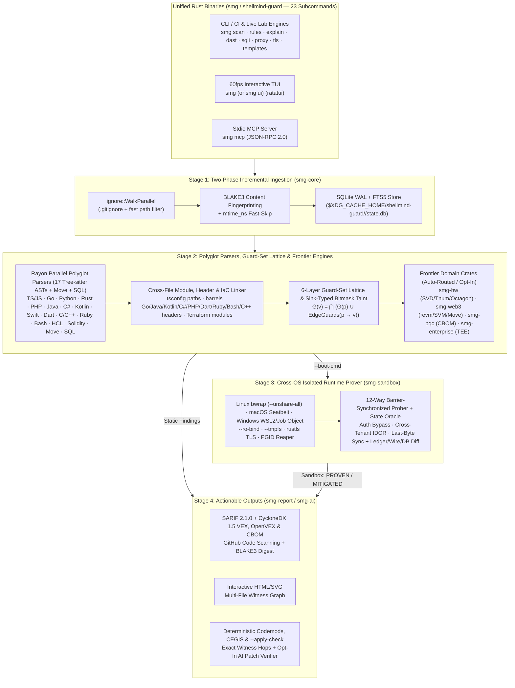
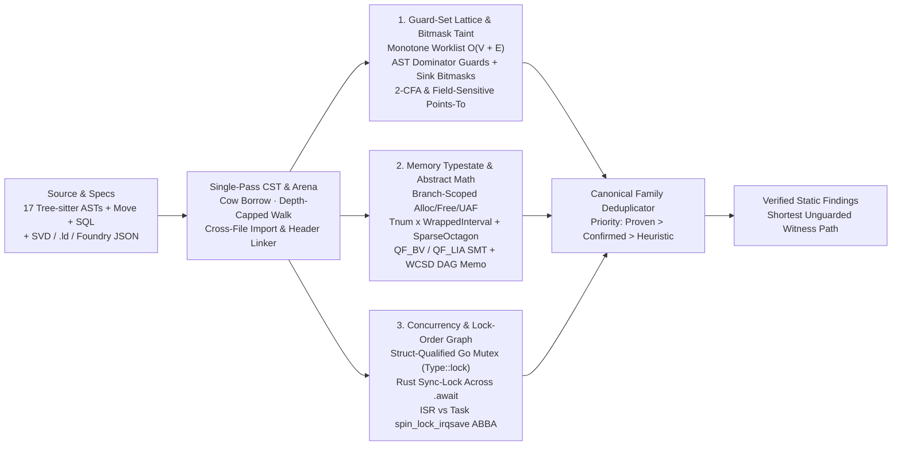
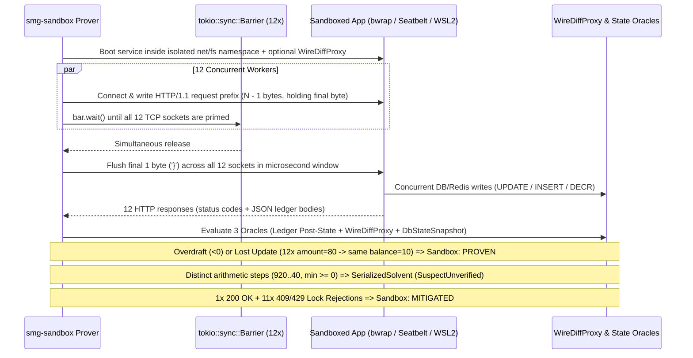

<div align="center">

<picture>
  <source media="(prefers-color-scheme: dark)" srcset="assets/wordmark-dark.svg">
  <source media="(prefers-color-scheme: light)" srcset="assets/wordmark-light.svg">
  
</picture>

**Compiler-Grade Multi-File Security, Business-Logic, Concurrency & Frontier Domain Verifier**

*Traces cross-file taint and guard invariants via an $O(V + E)$ Guard-Set Lattice across 18 source languages & ecosystems + SQL migrations (**17 Tree-sitter AST grammars**: TypeScript, JavaScript, Go, Python, Rust, PHP, Java, C#, Kotlin, Swift, Dart, C, C++, Ruby, Bash/Shell, Terraform/HCL, and Solidity—plus Move's structural parser and `.sql` schema analysis)—alongside isolated Hardware/Firmware (`smg-hw`), Web3 + `revm` Concrete Oracle (`smg-web3`), Post-Quantum Crypto-Agility (`smg-pqc`), and Confidential TEE (`smg-enterprise`) verification—then proves exploitability inside an isolated Cross-OS sandbox (`Linux bwrap`, `macOS sandbox-exec`, `Windows WSL2/Job Object`) with zero AI API cost.*

[](https://github.com/qira-dev/ShellMind-Guard/actions/workflows/ci.yml)
[](https://github.com/qira-dev/ShellMind-Guard/actions/workflows/benchmarks.yml)
[](LICENSE)
[](Cargo.toml)
[](crates/smg-sandbox)
[](#frontier-verification-domains-hw--web3--pqc--enterprise)
[](src/mcp.rs)
[](crates/smg-report)

[**Architecture**](#system-architecture) · [**Verification Engine (172 Rules)**](#the-6-layer-universal-verification-engine) · [**Frontier Domains**](#frontier-verification-domains-hw--web3--pqc--enterprise) · [**Benchmarks & Ground Truth**](#verified-performance-benchmarks--ground-truth-evidence) · [**Quickstart**](#quickstart) · [**CLI Reference (23 Commands)**](#cli-command-reference) · [**AI Agent MCP**](#model-context-protocol-shellmind-guard-mcp) · [**Blueprint**](BLUEPRINT.md)

</div>

---

## Why ShellMind Guard?

Modern software—especially high-velocity, AI-assisted full-stack codebases—suffers from vulnerabilities that span multiple files and execution layers: a route in `routes/checkout.ts` delegates to `services/ledger.ts`, which mutates a balance in `db/queries.ts` without an authentication middleware, ownership filter, or `SELECT ... FOR UPDATE` transaction lock.

Conventional security tools fail on these bugs in two predictable ways:

1. **Regex / Single-File SAST Scanners** lack cross-file call-graph and middleware-order semantics, burying engineering teams under hundreds of false positives while missing multi-hop business-logic and race-condition flaws.
2. **LLM-Only Code Scanners** burn tens of thousands of tokens per scan, hallucinate findings on sanitized paths, cannot execute deterministic data-flow proofs, and cannot verify whether a concurrency bug is actually exploitable at runtime.

**ShellMind Guard** solves both problems with a deterministic, systems-engineered architecture:

- **Two-Phase Incremental Ingestion (`BLAKE3` + `SQLite WAL`):** Fingerprints 13,000+ files at >1 GB/s, caching per-file `Tree-sitter` AST summaries in SQLite while **always re-linking the global cross-file call graph in RAM (<80 ms)** so edits to a shared middleware (`auth.ts`) immediately invalidate downstream routes (`routes.ts`).
- **$O(V + E)$ Guard-Set Lattice Solver:** Computes fixed-point security guard intersections across all incoming call paths without exponential $O(V!)$ path enumeration—terminating in linear time even on cyclic enterprise call graphs.
- **Universal 6-Layer + Cloud-Native Static & Taint Engine (`172` Cataloged Rules):** Covers hardcoded secrets, CORS/JWT/TLS/Dockerfile/Terraform/Kubernetes/CI-CD misconfigurations, offline lockfile advisories, cross-file SQL/Command/Path/SSRF/XSS/ZipSlip taint with sanitizer disproof, missing auth/PKCE/state-machine/transaction locks, IDOR missing ownership filters, and frontend-to-backend API/OpenAPI/GraphQL contract drift.
- **Cross-OS Isolated Exploit Prover (`smg-sandbox`):** Boots your service inside an isolated OS sandbox (**Linux `bwrap` `--unshare-all`**, **macOS `sandbox-exec` Seatbelt**, or **Windows WSL2 `bwrap` + Win32 Job Object** with optional `--sandbox-mem-mb` `RLIMIT_AS` / `--cgroup-v2`, `--sandbox-tls` loopback `rustls`, `--mock-shims`, fast `UNBOOTABLE` diagnostics, and process-group reaper) and fires barrier-synchronized **12-way Last-Byte Sync** concurrent HTTP/HTTPS bursts (`tokio::sync::Barrier` + `tokio::task::JoinSet`) corroborated by JSON ledger state-anomaly proofs, `WireDiffProxy` TCP mutation counters, and `DbStateSnapshot` conservation diffs.
- **Isolated Frontier Verification Domains (`hw` · `web3` · `pqc` · `enterprise`):** Zero-overhead on standard Web/AppSec repos—auto-activates `smg-hw` (`Tnum`/`SparseOctagon`/CMSIS-SVD/IRQ/Linker W^X) on firmware/kernel code and `smg-web3` (`tree-sitter-solidity`, Foundry/Hardhat, in-process **`revm` v43.0.3** concrete EVM oracle, Solana Anchor, Sui/Aptos Move) on Web3 repos, plus opt-in `smg-pqc` (Shor/Grover/BHT, Mosca HNDL, CycloneDX 1.5 Static CBOM) and `smg-enterprise` (remote Nitro/TDX/SEV-SNP TEE attestation & enclave admission control).
- **Native Model Context Protocol (`shellmind-guard mcp`) Server:** Exposes deterministic, zero-token-overhead security verification over `stdio` JSON-RPC 2.0 for **Claude Code, Cursor, AntiGravity, Windsurf, OpenCode, and Z-Code**.

---

## System Architecture



### Deep-Dive Pipeline: Formal Memory Typestate, Concurrency & Taint Dataflow

Inside Stage 2, every parsed file is lowered once into a bounded CFG & symbol summary and dispatched across three parallel formal verification engines before priority-ranked deduplication:



### Runtime Race Prover Protocol: 12-Way Last-Byte Sync & 3-Layer State Corroboration

When `--boot-cmd` or `smg replay` is invoked on a concurrency finding (`SMG-RACE-001`), `smg-sandbox` never relies on raw `HTTP 200` counts alone—it aligns final request bytes on an in-process barrier and cross-checks three state oracles:



### Mathematical Formulation: The $O(V + E)$ Guard-Set Lattice

Instead of enumerating all simple paths between routes and sinks (which degrades to $O(V!)$ on cyclic call graphs), ShellMind Guard formulates security invariant verification as a forward data-flow monotone lattice over the finite universe of security guards $\mathcal{U} = \{\text{Auth}, \text{TxLock}, \text{OwnershipCheck}, \text{SqlSanitizer}, \text{CmdSanitizer}, \text{PathSanitizer}, \text{SsrfSanitizer}, \text{XssSanitizer}, \text{CsrfProtection}\}$ paired with a sink-typed bitmask taint semilattice (preventing cross-sink sanitizer confusion):

$$\mathcal{G}_{\text{in}}(v) = \begin{cases} \emptyset & \text{if } v \in \text{EntryRoutes} \\ \displaystyle\bigcap_{p \in \text{Pred}(v)} \mathcal{G}_{\text{out}}(p) & \text{otherwise} \end{cases}, \qquad \mathcal{G}_{\text{out}}(v) = \mathcal{G}_{\text{in}}(v) \cup \text{LocalGuards}(v)$$

1. **Initialization:** Entry route nodes are initialized with their route-registration and router-level middleware guards; interior nodes start at top ($\top = \mathcal{U}$).
2. **Fixed-Point Convergence:** A worklist algorithm propagates guard sets in $O(V + E)$ time. Because $\mathcal{U}$ is finite and intersection is monotone, convergence is guaranteed on arbitrary cyclic graphs.
3. **Shortest Witness Extraction:** When a reachable sink $s$ requires guard $g \notin \mathcal{G}_{\text{out}}(s)$, a guard-avoiding multi-source BFS reconstructs the shortest unguarded witness chain $(r \to f_1 \to \dots \to s)$ in $O(V + E)$ time.

### Proof Tiers & Confidence Semantics (`Static-Proven` vs `Sandbox: PROVEN`)

ShellMind Guard keeps **static confidence tiers** (`Confidence` enum) strictly distinct from **runtime sandbox verification status** (`VerificationStatus` enum) so static mathematical proofs are never conflated with live HTTP exploit execution:

| Field / Badge | Value | Engine Origin | Exact Meaning & Required Evidence |
| :--- | :--- | :--- | :--- |
| **Runtime Status**<br>(`--boot-cmd` / `smg replay`) | **`Sandbox: PROVEN`**<br>(`VerificationStatus::Proven`) | `smg-sandbox` | Target service was booted inside an isolated OS sandbox and a live HTTP/HTTPS exploit probe succeeded (e.g. unauthenticated `200` mutation, cross-tenant User B IDOR read, or concurrent race violating ledger/wire/DB invariants). |
| **Runtime Status** | **`Sandbox: MITIGATED`**<br>(`VerificationStatus::Mitigated`) | `smg-sandbox` | Live sandbox probe was deterministically blocked by runtime controls (`401`/`403` auth gate, `409`/`429` lock/idempotency rejection). |
| **Static Confidence**<br>(`smg scan`, no server booted) | **`Confidence::Proven`**<br>*(Static-Proven / Bytecode-Proven)* | `smg-hw`, `smg-web3`, `smg-graph` | Defect is proven mathematically or via in-process bytecode execution without booting an HTTP server: e.g. `Tnum`/`SparseOctagon`/SVD register OOB & cyclic stack proofs (`349 Static-Proven` on `zephyr`), `revm` concrete EVM exploit execution, Trojan-Source `CVE-2021-42574` Bidi overrides, or malicious binary Pickle `REDUCE` opcodes. |
| **Static Confidence** | **`Confidence::Confirmed`** | `smg-graph`, `smg-web3` | Complete cross-file AST + Guard-Set Lattice witness path from an entry point to a sink with no dominating guard or matching sanitizer bit. |
| **Static Confidence** | **`Confidence::Heuristic`** | All static crates | Intra-procedural or pattern-level risk lacking full caller/environment certainty (filterable via `--min-confidence confirmed`). |

---

## The 6-Layer Universal Verification Engine

Every rule ID below maps 1-to-1 to [`RULE_CATALOG`](crates/smg-graph/src/rules.rs) (`172` built-in rules, CI-enforced against drift via [`tests/readme_catalog_sync.rs`](tests/readme_catalog_sync.rs); inspect any rule offline with `smg explain <RULE_ID>`):

| Layer / `--layers` Filter | Canonical `RULE_CATALOG` IDs | Severity | Category & Invariant Checked | Required Guard / Sanitizer Disproof |
| :---: | :--- | :---: | :--- | :--- |
| **1**<br>`secrets` | `SMG-SEC-APIKEY`, `SMG-SEC-AWS`, `SMG-SEC-STRIPE`, `SMG-SEC-GITHUB`, `SMG-SEC-OPENAI`, `SMG-SEC-ANTHROPIC`, `SMG-SEC-GCP`, `SMG-SEC-GOOGLE`, `SMG-SEC-SLACK`, `SMG-SEC-JWT`, `SMG-SEC-KEY`, `SMG-SEC-DBURI`, `SMG-SEC-CLIENT-ENV`, `SMG-SEC-ENTROPY`, `SMG-SEC-CUSTOM`, `SMG-SEC-ENV` | `CRITICAL`<br>`HIGH` | **Secrets, Private Keys & `.env` Exposure:** Provider-prefixed tokens (working tree + `--git-history` + opt-in `--verify-live`), hardcoded JWT tokens (`SMG-SEC-JWT`), PEM/SSH/PGP/Age private key blocks (`SMG-SEC-KEY`), credentials in DB URLs (`SMG-SEC-DBURI`), secrets bundled via `NEXT_PUBLIC_*`/`VITE_*` (`SMG-SEC-CLIENT-ENV`), Shannon entropy ($H > 4.3$) secrets, custom `.gitleaks.toml` rules (`SMG-SEC-CUSTOM`), and unignored `.env` files (`SMG-SEC-ENV`). | Excluded on lockfiles, test fixtures, dev/sample certs (`devenv/`, `localhost*.key`), placeholders (`EXAMPLE`, `YOUR_API_KEY`), and `.gitignore`-covered `.env` files. |
| **1**<br>`config` | `SMG-CFG-CORS`, `SMG-CFG-JWT-LOGIC`, `SMG-CFG-TLS`, `SMG-CFG-CRYPTO`, `SMG-CFG-DEBUG`, `SMG-CFG-COOKIE`, `SMG-CFG-HTTP-HOST`, `SMG-CFG-SMUGGLE`, `SMG-CFG-DOCKER`, `SMG-CFG-PROTO`, `SMG-CFG-XXE`, `SMG-CFG-SQL-EXEC`, `SMG-CFG-SQL-SEARCHPATH`, `SMG-CFG-SQL-RLS`, `SMG-CFG-SQL-PRIV`, `SMG-CFG-IAC-PUBLIC`, `SMG-CFG-IAC-NET`, `SMG-CFG-IAC-CRYPTO`, `SMG-CFG-IAC-IAM`, `SMG-CFG-IAC-LOG`, `SMG-CFG-IAC-IPC` | `CRITICAL`<br>`HIGH`<br>`MEDIUM` | **App Config, Cloud IaC (`Terraform/HCL`) & `.sql` Policies:** Wildcard CORS + credentials, unverified `jwt.decode` / `alg: "none"`, disabled TLS, weak config crypto, `DEBUG=True`, insecure cookies, `ALLOWED_HOSTS=['*']`, proxy header smuggling, privileged `Dockerfile`, prototype pollution, XXE, `.sql` migration hazards (`EXECUTE format`, `SECURITY DEFINER`, disabled RLS, `SUPERUSER`), and 78 Checkov-class AWS/GCP/Azure HCL policies (`SMG-CFG-IAC-*`). | Restrict origins/hosts/CIDRs, verify JWT signatures, enable KMS/TLS 1.2+/audit logging, disable XXE DTDs, enforce S3 public-access blocks, and harden `.sql` procedures. |
| **2**<br>`deps` | `SMG-DEP-001`, `SMG-DEP-PROVEN`, `SMG-DEP-SAFEAPI` | `CRITICAL`<br>`HIGH`<br>`LOW` | **Offline Lockfile & Call-Graph Reachability Audit:** Parses `package.json`, `package-lock.json`, `Cargo.toml`, `Cargo.lock`, `go.mod`, `requirements.txt`, `pyproject.toml`, `poetry.lock`, and `uv.lock` against embedded advisories and local SQLite OSV cache (`smg deps sync`), upgrading imported vulnerable symbols to `SMG-DEP-PROVEN` and downgrading unreferenced symbols to `SMG-DEP-SAFEAPI` (with `--openvex` export). | Pin semver ranges, upgrade vulnerable packages, and export reachability-backed VEX (`--openvex`). |
| **3**<br>`sqli` · `xss` · `cmdi` · `path` · `ssrf` | `SMG-SQLI-001`, `SMG-SQLI-NOSQL`, `SMG-SQLI-MASS`, `SMG-XSS-001`, `SMG-CMDI-001`, `SMG-CMDI-SSTI`, `SMG-CMDI-DESER`, `SMG-PATH-001`, `SMG-SSRF-001`, `SMG-SSRF-REDIRECT`, `SMG-REDIRECT-001` | `CRITICAL`<br>`HIGH` | **Cross-File Sink-Typed Taint Engine:** Tracks untrusted input across imports, struct fields, and closures into SQL/NoSQL/ORM mass assignment, HTML/DOM XSS, OS shell / SSTI / `pickle`/`yaml`/`ObjectInputStream` deserialization, filesystem path traversal, and server-side HTTP SSRF / open redirects. | Sink-matched sanitizer disproof: parameterized SQL (`$1`/`?`), `DOMPurify`/`ammonia`/`html.escape`, argv-array `Command` without shell, `yaml.safe_load`, `filepath.Clean` + prefix check, and CIDR/host allowlists. |
| **4**<br>`auth` · `csrf` · `idor` · `oauth` · `state` | `SMG-AUTH-001`, `SMG-CSRF-001`, `SMG-IDOR-001`, `SMG-AUTH-PKCE`, `SMG-OAUTH-001`, `SMG-STATE-001` | `HIGH` | **Authentication, Tenant Ownership, OAuth2 & State Machines:** Missing `Auth` middleware on privileged mutations (`SMG-AUTH-001`), cookie endpoints without CSRF protection (`SMG-CSRF-001`), resource lookups missing caller ownership predicates (`SMG-IDOR-001`), OAuth2 flows missing PKCE/`state`/pinned `redirect_uri` (`SMG-AUTH-PKCE`, `SMG-OAUTH-001`), and fulfillment/payout transitions skipping prior-state checks (`SMG-STATE-001`). | Dominating auth guards, `SameSite`/CSRF tokens, `owner_id = current_user.id` scoping, S256 PKCE + `state` binding, and explicit prior-state `WHERE status = ...` guards. |
| **5**<br>`race` · `engine` · `memory` | `SMG-RACE-001`, `SMG-ENG-DEADLOCK`, `SMG-CONC-DEADLOCK`, `SMG-ENG-LEAK`, `SMG-MEM-BOUNDS`, `SMG-ENG-INT` | `CRITICAL`<br>`HIGH` | **Concurrency, Deadlocks, Resource Leaks & Native Memory Safety:** Non-atomic balance/inventory updates (`SMG-RACE-001`), cross-function `A->B / B->A` lock inversions (`SMG-ENG-DEADLOCK`), sync `Mutex`/`RwLock` held across `.await` (`SMG-CONC-DEADLOCK`), leaked file/socket/DB handles on early error returns (`SMG-ENG-LEAK`), C/C++/Rust `unsafe` buffer/UAF/uninit UB (`SMG-MEM-BOUNDS`), and allocation `a * b` integer overflow (`SMG-ENG-INT`). | ACID `withTransaction`/`SELECT ... FOR UPDATE`, canonical lock order, drop sync guards before `.await`, RAII/`defer`, and checked bounds/arithmetic. |
| **6**<br>`frontend` · `api` · `smuggle` | `SMG-FE-404`, `SMG-FE-ERR`, `SMG-FE-STORAGE`, `SMG-FE-MSG`, `SMG-FE-TABNAB`, `SMG-API-001`, `SMG-OAPI-INSECURE-SERVER`, `SMG-OAPI-NO-AUTH-SCHEME`, `SMG-OAPI-BASIC-AUTH`, `SMG-OAPI-APIKEY-QUERY`, `SMG-GQL-NO-QUERY-ROOT`, `SMG-GQL-SENSITIVE-FIELD`, `SMG-GQL-DEBUG-FIELD`, `SMG-GQL-INTROSPECTION`, `SMG-HTTP-SMUGGLE` | `HIGH`<br>`MEDIUM`<br>`LOW` | **Frontend ↔ Backend Contracts, OpenAPI/GraphQL & HTTP Framing:** Frontend calls to non-existent backend routes (`SMG-FE-404`), swallowed rejections (`SMG-FE-ERR`), token storage in `localStorage` (`SMG-FE-STORAGE`), unverified `postMessage` (`SMG-FE-MSG`), `target="_blank"` tabnabbing (`SMG-FE-TABNAB`), OpenAPI/GraphQL/WebSocket security posture (`SMG-API-001`, `SMG-OAPI-*`, `SMG-GQL-*`), and CRLF/Host smuggling (`SMG-HTTP-SMUGGLE`). | Align route contracts, store auth in `httpOnly` cookies, verify `event.origin`, disable prod GraphQL introspection, require bearer OAuth schemes, and strip CRLF/untrusted `Host`. |
| **Cloud & Runtime**<br>`cicd` · `k8s` · `dos` · `zip` · `crypto` · `queue` | `SMG-CICD-001`, `SMG-CICD-002`, `SMG-K8S-001`, `SMG-K8S-002`, `SMG-DOS-001`, `SMG-ZIP-001`, `SMG-CRYPTO-001`, `SMG-QUEUE-001` | `CRITICAL`<br>`HIGH` | **CI/CD Workflows, Kubernetes, Archive, Crypto & Queue Hygiene:** GitHub Actions `pull_request_target` expression injection & `write-all`/unpinned actions (`SMG-CICD-*`), privileged/`hostPID` pods & wildcard RBAC (`SMG-K8S-*`), exponential ReDoS regexes (`SMG-DOS-001`), ZipSlip archive extraction (`SMG-ZIP-001`), `AES-ECB`/static IV/non-constant-time MACs (`SMG-CRYPTO-001`), and async queue consumers dropping tenant/auth context (`SMG-QUEUE-001`). | Pin Actions by SHA with minimal permissions, drop pod capabilities, bound regexes, canonicalize archive paths, use AEAD + `subtle::ConstantTimeEq`, and re-verify tenant context in workers. |
| **Mobile**<br>`mobile` | `SMG-MOB-STORAGE`, `SMG-MOB-IPC`, `SMG-MOB-TLS` | `CRITICAL`<br>`HIGH` | **Auto-Routed Mobile Security (`Android`/`iOS`/`Flutter`):** Activated when `AndroidManifest.xml`, `Info.plist`, or `pubspec.yaml` exist: plaintext `SharedPreferences`/`UserDefaults`/`Hive` secrets (`SMG-MOB-STORAGE`), exported permissionless Android components / mutable `PendingIntent` / WebView bridges (`SMG-MOB-IPC`), and trust-all TLS / cleartext ATS bypasses (`SMG-MOB-TLS`). | Use `EncryptedSharedPreferences`/Keychain/`FlutterSecureStorage`, set `android:exported="false"`, and enforce strict TLS validation. |
| **Deep & Live DAST**<br>`deep` (`--deep`)<br>`dast` (`smg dast`) | `SMG-FUZZ-SCHEMA`, `SMG-FUZZ-TAMPER`, `SMG-FUZZ-CRASH`, `SMG-FUZZ-ENCODING`, `SMG-SANDBOX-UNBOOTABLE`, `SMG-BOOT-001`, `SMG-DAST-SQLI`, `SMG-DAST-XSS`, `SMG-DAST-CMDI`, `SMG-DAST-SSTI`, `SMG-DAST-LFI`, `SMG-DAST-REDIRECT`, `SMG-DAST-CORS`, `SMG-DAST-COOKIE`, `SMG-DAST-CSP`, `SMG-DAST-HSTS`, `SMG-DAST-CLICKJACK`, `SMG-DAST-NOSNIFF`, `SMG-DAST-REFERRER`, `SMG-DAST-PERMS`, `SMG-DAST-CACHE`, `SMG-DAST-POWERED`, `SMG-DAST-SERVER-LEAK`, `SMG-DAST-DOMXSS-SRC-SINK`, `SMG-DAST-GRAPHQL-INTROSPECTION` | `CRITICAL`<br>`HIGH`<br>`MEDIUM`<br>`LOW`<br>`INFO` | **Schema Fuzzing & ZAP-Class Live DAST (`--spa` Headless Chrome):** Static/OpenAPI numeric schema validation (`SMG-FUZZ-SCHEMA`), sandbox negative/zero/5xx/UTF-8 fuzzing (`SMG-FUZZ-*`), and non-destructive live DAST + headless Chrome CDP DOM source-to-sink auditing (`SMG-DAST-*`). | Enforce positive finite numeric schemas (`gt=0`), reject malformed payloads with `400/422`, and harden CSP/HSTS/cookie/CORS headers. |

---

## Frontier Verification Domains (`hw` · `web3` · `pqc` · `enterprise`)

Built as isolated, feature-gated workspace crates (`default = ["hw", "web3", "pqc", "enterprise"]`) with **zero latency overhead** on standard Web/AppSec repositories:

| Crate / Flag | Canonical `RULE_CATALOG` IDs | Severity | Mathematical / Execution Engine | Required Guard / Proof Tier |
| :--- | :--- | :---: | :--- | :--- |
| **`smg-hw`**<br>`--layers hw` | `SMG-HW-MMIO`, `SMG-HW-BOUNDS`, `SMG-HW-TOCTOU`, `SMG-HW-IRQ`, `SMG-HW-TYPESTATE`, `SMG-HW-BOOT`, `SMG-HW-CT`, `SMG-HW-SECRETS`, `SMG-HW-STACK`, `SMG-HW-DMA`, `SMG-HW-LINKER` | `CRITICAL`<br>`HIGH`<br>`MEDIUM` | **Hardware, Firmware & Kernel Verification:** Parses `compile_commands.json`, CMSIS-SVD peripherals (`derivedFrom`, `<addressBlock>`), and GNU `.ld` linker memory regions (`SMG-HW-LINKER` W^X `rwx` & `SMG-HW-STACK` overlap/WCSD); runs width-masked `Tnum` & `WrappedInterval` ($I_w \bowtie T_w$), `i128` `SparseOctagon` ($k \le 12$), DMA cache-coherency checks (`SMG-HW-DMA`), alloc/free typestate, and cross-function ISR/ABBA lock checks. | Enforces Flash/SRAM W^X separation, bounded task+ISR stack budgets, D-Cache clean/invalidate around DMA, dominating boot signature + anti-rollback gates, `spin_lock_irqsave`, and key zeroization. |
| **`smg-web3`**<br>`--layers web3` | `SMG-WEB3-REENTRANCY`, `SMG-WEB3-STORAGE`, `SMG-WEB3-ACCESS`, `SMG-WEB3-ROUNDING`, `SMG-WEB3-ORACLE`, `SMG-WEB3-SPOT-ORACLE`, `SMG-WEB3-ORACLE-STALE`, `SMG-WEB3-ERC4626-INFLATION`, `SMG-WEB3-UUPS-UNINIT`, `SMG-WEB3-IMPL-SELFDESTRUCT`, `SMG-WEB3-FLASHLOAN-AUTH`, `SMG-WEB3-DIAMOND-CLASH`, `SMG-WEB3-REPLAY`, `SMG-WEB3-SOLANA`, `SMG-SOL-INIT-IF-NEEDED`, `SMG-SOL-PDA-NONCANONICAL`, `SMG-SOL-ARBITRARY-CPI`, `SMG-WEB3-MOVE`, `SMG-MOVE-ABILITY-LEAK`, `SMG-MOVE-SHARED-CAP`, `SMG-MOVE-ENTRY-NO-AUTH` | `CRITICAL`<br>`HIGH` | **Web3, DeFi, Solana & Move Verification:** `tree-sitter-solidity` CST + Foundry (`out/*.json`) / Hardhat ingestion; EIP-1967/ERC-7201/EIP-2535 Diamond slot & selector algebra; 5-tuple CEI + read-only reentrancy; ERC-4626 inflation & Chainlink/AMM spot oracle checks; **in-process `revm` v43.0.3 concrete EVM bytecode oracle**; `Context<T>`-scoped Solana Anchor CPI/PDA checks; and Sui/Aptos Move ability & capability witness checks. | Upgrades verified EVM reentrancy/unauth-init exploits to **`Confidence::Proven`** via `revm`; enforces `_disableInitializers()`, TWAP/freshness checks, pinned Solana CPI program IDs, canonical PDA bumps, and Move `&AdminCap` guards. |
| **`smg-pqc`**<br>`--compliance pqc`<br>`--cbom <FILE>`<br>`smg tls` | `SMG-PQC-HNDL`, `SMG-PQC-SHOR`, `SMG-PQC-GROVER`, `SMG-PQC-HYBRID`, `SMG-PQC-DOWNGRADE`, `SMG-PQC-PARAMS`, `SMG-X509-WEAK-SIG`, `SMG-X509-EXPIRED`, `SMG-X509-NO-SAN`, `SMG-ELF-BROKEN-CRYPTO`, `SMG-ELF-QUANTUM-VULN`, `SMG-TLS-WEAK-CIPHER`, `SMG-TLS-PQC-READY`, `SMG-TLS-HSTS`, `SMG-TLS-LEGACY` | `CRITICAL`<br>`HIGH`<br>`MEDIUM`<br>`INFO` | **Post-Quantum Crypto-Agility, X.509/ELF & Live TLS/STARTTLS:** Evaluates Shor zeroing ($B_{\text{PQ}} = 0$), Grover halving ($b/2$), BHT collision ($h/3$), and Mosca HNDL urgency $T_{\text{HNDL}} = (X_u + Y_u) - Z$; audits X.509 `.der` certs, `.elf`/`.so` crypto symbols, and live TLS/STARTTLS (`X25519MLKEM768`); and emits **CycloneDX 1.5 Static CBOM** (`runtimeUnobserved: true`). | Migrates KEX to `X25519MLKEM768` / `ML-KEM-768+`, signatures to `ML-DSA-65+` / `SLH-DSA`, symmetric ciphers to AES-256 / SHA-384+, and disables SSLv3/TLS 1.0/1.1. |
| **`smg-enterprise`**<br>`smg enterprise ...`<br>`smg verify-attestation` | `status`, `verify-attestation`, `verify-license`, `remote-scan` *(CLI subcommands, not static rules)* | Fail-Closed | **Confidential Compute TEE Attestation, Merkle Audit Log & Remote Enclave Auth:** Hardware TEE quote verification (`Intel TDX v4`, `AMD SEV-SNP`, `AWS Nitro COSE_Sign1`), append-only BLAKE3 `MerkleAuditLog` ($O(\log N)$ inclusion proofs), and Ed25519 + binary-BLAKE3 token verification for remote TEE enclave servers. | Fails closed on debug-enabled enclaves (`TD_ATTR_DEBUG`/`DEBUG`), unpinned PCR0/MRTD measurements, expired/unverified enclave tokens, or non-HTTPS remote endpoints. |
| **AI / LLM / MCP & Model Security**<br>`--layers ai`<br>`--deep-audit` | `SMG-AI-001`, `SMG-AI-INDIRECT-PROMPT-INJ`, `SMG-AI-LLM-TO-TOOL-RCE`, `SMG-MCP-TOOL-POISONING`, `SMG-MCP-UNICODE-STEGO`, `SMG-MCP-UNSAFE-STDIO`, `SMG-AI-TORCH-PICKLE`, `SMG-AI-PICKLE-RCE`, `SMG-AI-PICKLE-MALICIOUS-OPCODE`, `SMG-AI-CHAT-TEMPLATE-SSTI`, `SMG-AI-REMOTE-CODE` | `CRITICAL`<br>`HIGH` | **AI Agent, MCP & ML Supply-Chain Engine:** Indirect Prompt Injection taint graph (`RAG/Web/Email -> Prompt -> LLM -> Tool/Exec`), MCP tool-poisoning & Trojan-Source Bidi / Unicode Tag steganography (`U+200B`, `U+202A..U+202E`, `U+2066..U+2069`, `U+E0000..U+E007F`), pure-Rust binary Pickle opcode inspection (`.pkl`/`.pt`/`.pth` + 64 KiB ZIP EOCD), and Jinja2 `chat_template` SSTI inspection. | Enforces data spotlighting/sanitizers, pinned MCP tool schemas, `weights_only=True` / `safetensors`, and sandboxed Jinja2 environments. |

> **Why does an Apache-2.0 open-source repository include `smg enterprise verify-license`?**  
> **Zero local features are license-gated.** Every static rule (`172/172`), frontier crate (`hw`, `web3`, `pqc`), sandbox prover, DAST/SQLi/MITM proxy tool, CBOM/OpenVEX exporter, TUI, and MCP server runs 100% locally and unencumbered under Apache-2.0 with **no license check, no telemetry, and no network call**. The Ed25519 token verifier in [`crates/smg-enterprise/src/license.rs`](crates/smg-enterprise/src/license.rs) is a **server-side admission-control primitive** for organizations operating their own multi-tenant **remote Confidential Compute TEE Enclave (`smg enterprise remote-scan`)**, allowing the enclave host (where code cannot be modified by untrusted callers) to verify caller authorization and client binary `BLAKE3` measurements before allocating enclave compute.

### New in `v1.5.5` — 10-Repo Real-World Scalability Breakthrough (>100x Faster `smg-hw`), Precision & Security Hardening
- **72k-File Embedded & Monorepo Scalability (`zephyr` `>24m47s` → `2m21s`, `smg-hw` `14.94s`):** Eliminated eager `#define` macro map cloning per function and per branch in `smg-hw` (`typestate_irq.rs`, lazy `lookup_const_define`, deterministic sorted `compile_unit_suffix_index`, `65,536`-entry define cap), replaced the $O(N^2)$ ABBA lock-pair loop with an $O(P)$ hash index, upgraded `compute_wcsd_for_target` to depth-valid memoization (`min_valid_depth` + `500k` step budget) with file-scoped resolution and single-pass Tree-sitter reuse, wired `cfg.scan.max_threads` into `smg-hw`, filtered non-embedded `.ld` scripts and generic desktop tokens (`compile_commands.json`/`read_volatile`/`mmio`), added $O(N)$ pre-gates in `ai_mcp_model.rs` and $O(1)$ bounds tracking in `memory.rs`, and introduced `--profile-phases` / `SMG_PROFILE_PHASES=1` timing telemetry.
- **Web3, Secrets & AI Precision Without Recall Loss:** Added canonical defect-family deduplication in `smg-web3` (`0` same-line `SMG-WEB3-SOLANA` + `SMG-SOL-ARBITRARY-CPI` duplicates on `wormhole`, scan time `55.55s` → `29.29s`), Anchor PDA/pinned-address & hardcoded CPI program-ID recognition, and Sui/Aptos Move `public(package)`/`public(friend)` + capability witness handling; calibrated test/dev/sample `SMG-SEC-KEY` paths (`devenv/`, `demos/`, `samples/`, `localhost*.key`/`.pem`) while preserving `OWASP/crAPI` `30/30` tracked baseline findings (`SQLI=1`, `AUTH=16`, `JWT=7`, `SEC_KEY=6`); scoped `Language::Config` away from Python deserialization checks (`.pre-commit-config.yaml` = `0`), required loader context for `trust_remote_code=True`, and calibrated `benchmarks/`/`examples/` AI findings while keeping runtime `torch.load` (`vllm/model_executor/.../weight_utils.py`) at `CRITICAL / Confirmed`.
- **Go Concurrency, Trojan-Source (`CVE-2021-42574`), Sandbox Ledger Proof & Catalog Sync:** Qualified Go struct receiver locks via `enclosing_type`, package-scoped cross-file Go deadlock cycles, ignored `RLock -> RLock` pairs, and made early-return `Unlock()` brace-aware; closed Trojan-Source Bidi bypasses with standalone 1-char constant scrubbing and ordered isolate depth (`iso_depth` underflow/balance checks); added JSON ledger lost-update/overdraft vs serialized-solvent discrimination in `smg-sandbox`; and enforced CI drift parity across `RULE_CATALOG` (`172` rules), CLI subcommands, and `README.md`.

### New in `v1.5.0` — 5-Batch Cross-Audit Remediation, Multi-Domain Wiring & Soundness Hardening
- **Static Engine, SMT & Memory Typestate Precision:** Bounded all remaining recursive AST walkers across 8 languages + `ast.rs`, upgraded `filter_dominating_body_guards` to structural Tree-sitter AST dominance (with `if`/`else` intersection, negated-exit promotion, and brace-free Ruby support), fixed `mem_typestate.rs` `free(p); p = p->next;` RHS-before-rebind UAF + `#ifdef` Tree-sitter function isolation + single-line Rust mutex drops, wired `FieldSensitivePointsTo` & `KCfaContextTable`, enforced pre-sink `OwnershipCheck`/`CsrfProtection`, added monotonic `SymbolArena` overflow IDs, priority-ranked deduplication, sort-disambiguated SMT-LIB2 declarations, and `&mut x`/mutating-method SMT invalidation.
- **Secrets, OpenVEX, Large Pickle ZIP EOCD & Multi-File IaC:** Wired working-tree `GitleaksConfig` custom rules + `trust_repo_config`-gated allowlists, wired `AutoVexSymbolIndex` into `--openvex` OpenVEX v0.2.0 export, added bounded 64 KiB file-tail ZIP `EOCD`/Central Directory inspection (`inspect_pickle_file_path`) + strict ML pickle allowlist, and added cross-file `WorkspaceHclVars` (`.tfvars` / `variables.tf` / `aws_s3_bucket_public_access_block`).
- **Frontier Domains (`smg-web3` & `smg-hw`), Live DNS Pinning & Containment:** Replaced Solana CPI booleans with field-specific `validated_program_fields`, added two-pass Solidity struct slot sizing + `IERC20`/`enum` Diamond ABI canonicalization + `revm` attacker-gain solvency, zero-storage ETH drain, and view-reentrancy probes; wired `smg-hw` inter-procedural WCSD (cycle/depth-safe) + `SMG-HW-LINKER` RWX checks + `arg0`-only `memcpy` bounds; wired DNS pinning across all live HTTP engines & `smg-ai`; masked `/app/.git` & `/app/.env*` in Linux `bwrap` and scoped macOS Seatbelt writes to per-run `TMPDIR`; wired `audit_upgraded_starttls_stream` into `smg tls --starttls`, staged-index `git checkout-index` pre-commit scanning, LAN-to-loopback proxy SSRF `403`, remote CDP loopback/RFC1918 blocking, `smg http-audit --passive-only`, async `proxy_tui` replay/intruder, and full multi-domain `--apply-check` / TUI `[r]` rescan.

### New in `v1.4.1` — 6-Batch Full-Workspace Security & Soundness Hardening
- **Trust-Loader & Bounded Sensitive-File Discovery:** Enforced `load_trusted_from_dir` (stripping untrusted `ignore_paths` on untrusted repos), preserved `.gitignore` on source walks with a separate bounded sensitive-file pass + optional `--no-gitignore`, and tightened distro-aware OSV & OCI image parsing.
- **Static Engine & Domain Scanner Soundness:** Fixed CFG guard-union polarity & `budget_exhausted` propagation, upgraded middleware guard propagation to a true convergence fixpoint worklist, blocked `public_routes = ["/*"]` wildcards, hardened JSX sanitizer checks, fixed taint polarity/recursion caps & OpenAPI merge order, prevented SMT `&&` partial-parse false UNSAT, hardened IaC/AI/MCP/Mobile/Web3/HW/PQC scanners, and synchronized `RULE_CATALOG`.
- **Live Engines, Fail-Closed Attestation & Supply-Chain Hardening:** Enforced unconditional IMDS/link-local deny across all live engines on final resolved destinations (even with `--allow-remote`), removed OS-shell CMDi metacharacters from default safe DAST mode, enforced fail-closed TEE attestation (`verified: false`, `cryptographically_verified: false`, TDX `48+120` offset fix), hardened MCP/TUI/Sandbox/Reports, and made `hooks/hooks.json`, `install.sh`, `install.ps1`, and CI/Release workflows fail-closed with tag-parity & `SHA256SUMS.txt` provenance attestation.

### New in `v0.4.0` & `v0.3.0` — Full Tool-Parity & Ultra-Depth Engines
- **Burp CE-Class Local MITM Proxy (`smg proxy --mitm-ca` & `smg proxy export-ca`):** Opt-in local ECDSA P-256 Root CA (`0700`/`0600`), on-the-fly IP/DNS leaf signing, HTTP/1.1 keep-alive multi-request tunnels, WebSocket upgrade logging (`kind: "ws"`), HTTPS replay in TUI, and strict OS-validated upstream TLS for remote origins.
- **ZAP-Class Headless Chrome SPA & DOM-XSS (`smg dast --spa`, `smg http-audit --spa`):** Synchronous Chrome DevTools Protocol (`cdp_engine.rs`), `0700` throwaway profiles, authenticated crawl (`--cookie`, `--auth-header`), XHR/Fetch harvesting, and DOM source-to-sink tracking (`location.hash`/`search` → `innerHTML`/`eval`).
- **Nuclei-Class Multi-Engine Templates & Self-Hosted OOB (`smg templates`, `smg oob serve`) + sqlmap-Class Prover (`smg sqli`):** `ssl:`, `websocket:`, `headless:`, `file:`, `flow:` multi-step templates with loopback OOB callbacks, plus non-destructive JSON/GraphQL/multipart boolean & timing differential SQLi verification (`[SMG-VAR]` normalization).
- **Formal Core, STARTTLS, Confidential Computing & OpenVEX:** `smg scan --openvex`, `smg tls --starttls smtp|imap|ftp`, `smg verify-attestation --platform tdx|sev-snp|nitro`, pure-Rust `QF_BV` / `QF_LIA` (`i128` GCD + Fourier-Motzkin) / `k-CFA` ($k=2$), loopback RFC 9113 HTTP/2 Single-Packet `END_STREAM` race + DB snapshot diff, and polyglot multi-hunk semantic AST patcher.

### Supported Languages & Frameworks (`17` Tree-sitter AST Grammars + Move + SQL)

| Language / DSL | Parser / AST Grammar (`Crate`) | Frameworks, Schemas & Idioms Extracted Automatically |
| :--- | :--- | :--- |
| **TypeScript / JavaScript** (`.ts`, `.tsx`, `.js`, `.jsx`, `.mjs`, `.cjs`) | `tree-sitter-typescript` (TS & TSX), `tree-sitter-javascript` (`smg-graph`) | Express, Fastify, Hono, Koa, **Next.js App Router** (`export async function GET/POST/PUT/DELETE/PATCH`), **NestJS** (`@Controller`, `@Get`/`@Post`, `@UseGuards`), **tRPC** (`publicProcedure`, `protectedProcedure`), Prisma, Drizzle, React/Next.js Frontend (`fetch`, `axios`) |
| **Go** (`.go`) | `tree-sitter-go` (`smg-graph`) | `net/http` (`http.HandleFunc`, `mux.HandleFunc`), **Gin** (`r.GET`, `r.Group`, `.Use`), **Echo**, **Chi**, `database/sql` (`db.Query`, `db.Exec`, `tx.Exec`), `sync.Mutex` / `RWMutex`, `os/exec` |
| **Python** (`.py`) | `tree-sitter-python` (`smg-graph`) | **FastAPI** (`@app.get`, `@router.post`, `Depends`), **Flask** (`@app.route`, `request.args`), **Django** (`path()`, `@login_required`, `.objects.get/filter`), PyTorch/HuggingFace loaders, `cursor.execute`, `subprocess` |
| **Rust** (`.rs`) | `tree-sitter-rust` (`smg-graph`) | **Axum** (`Router::new().route()`, `.layer()`), **Actix-Web** (`#[get("/...")]`, `#[post("/...")]`, `web::Path`, `web::Query`), `unsafe` `MaybeUninit`/ptr bounds, `Mutex`-across-`.await`, `sqlx`, `tokio::process::Command` |
| **PHP** (`.php`, `.phtml`) | `tree-sitter-php` (`smg-graph`) | **Laravel** (`Route::get/post/...`, `middleware('auth')`, `DB::transaction`, `DB::select`), **Symfony** (`#[Route]`, `#[IsGranted]`), PDO `prepare()`, PSR-4 `use` resolution |
| **Java** (`.java`) | `tree-sitter-java` (`smg-graph`) | **Spring Boot / MVC** (`@RestController`, `@RequestMapping`, `@GetMapping`/`@PostMapping`, `@PreAuthorize`, `@Transactional`), **JAX-RS** (`@Path`, `@GET`/`@POST`), JDBC `PreparedStatement` |
| **C#** (`.cs`) | `tree-sitter-c-sharp` (`smg-graph`) | **ASP.NET Core MVC** (`[Route]`, `[HttpGet]`/`[HttpPost]`, `[Authorize]`, `[ValidateAntiForgeryToken]`) & **Minimal APIs** (`app.MapGet`/`MapPost`, `.RequireAuthorization()`), Entity Framework (`FromSqlRaw` vs `FromSqlInterpolated`) |
| **Kotlin** (`.kt`, `.kts`) | `tree-sitter-kotlin-ng` (`smg-graph`) | **Ktor** (`routing { get/post }`, `authenticate("...")`, `call.parameters`), **Spring Boot Kotlin** (`@RestController`, `@PreAuthorize`), **Android** (`Intent`, `SharedPreferences`, `rawQuery`, `execSQL`) |
| **Swift** (`.swift`) | `tree-sitter-swift` (`smg-graph`) | **Vapor** (`app.get/post`, `app.grouped(User.authenticator())`, `req.db.transaction`, `sql.raw` + `binds:`), **iOS** (`URLSession`, `UserDefaults`, `FileManager`, `sqlite3_exec` vs `sqlite3_prepare`) |
| **Dart** (`.dart`) | `tree-sitter-dart` (`smg-graph`) | **Dart Frog** (`routes/**` `onRequest`), **Shelf** (`shelf_router` `router.get/post`), Flutter `Hive` / `FlutterSecureStorage`, `rawQuery`/`rawUpdate`/`Process.run` |
| **C / C++** (`.c`, `.h`, `.cpp`, `.cc`, `.cxx`, `.hpp`, `.hh`, `.hxx`) | `tree-sitter-c`, `tree-sitter-cpp` (`smg-graph` + `smg-hw`) | `#include` header-to-implementation resolution, **Crow** (`CROW_ROUTE`), **cpp-httplib** (`svr.Get/Post`), branch-scoped UAF/Double-Free/bounds, CMSIS-SVD MMIO/DMA/ISR/WCSD firmware verification |
| **Ruby** (`.rb`, `.rake`, `.ru`) | `tree-sitter-ruby` (`smg-graph`) | **Ruby on Rails** (`routes.rb` `to: 'ctrl#act'`, `resources`, `before_action :authenticate_user!`, `skip_before_action :verify_authenticity_token`, ActiveRecord `.transaction` / `.where`), **Sinatra**, `Shellwords.escape` |
| **Bash / Shell** (`.sh`, `.bash`, `.zsh`) | `tree-sitter-bash` (`smg-graph`) | `source`/`.` cross-file linking, `eval` / `sh -c` / `curl \| bash` (`SMG-CMDI-001`), `psql`/`mysql`/`sqlite3` SQLi, dynamic `curl`/`wget` SSRF, `rm -rf` path taint (clean on `mktemp`/`printf '%q'`/regex guards) |
| **Terraform / HCL** (`.tf`, `.tfvars`) | `tree-sitter-hcl` (`smg-graph`) | Local `module` `source` + `.tfvars` linking, public S3/GCS/RDS exposure (`SMG-CFG-IAC-PUBLIC`), `0.0.0.0/0` ingress (`SMG-CFG-IAC-NET`), disabled encryption/TLS (`SMG-CFG-IAC-CRYPTO`), IAM `*/*` (`SMG-CFG-IAC-IAM`), disabled logging/IPC isolation (`SMG-CFG-IAC-LOG`, `SMG-CFG-IAC-IPC`) |
| **Solidity** (`.sol`) | `tree-sitter-solidity` (`smg-web3`) | Foundry (`out/*.json`) & Hardhat artifacts, ERC-1967 / ERC-7201 / EIP-2535 Diamond layouts, ERC-4626 vaults, Chainlink/AMM oracles, EIP-712/ECDSA, CEI & read-only reentrancy + **`revm` v43.0.3** concrete EVM oracle |
| **Move** (`.move`) | Structural Move parser (`smg-web3`) | Sui & Aptos modules (`public entry` vs internal `public(package)`/`public(friend)`), `copy`/`drop` hot-potato ability leaks (`SMG-MOVE-ABILITY-LEAK`), shared admin caps (`SMG-MOVE-SHARED-CAP`), and `&AdminCap` / `signer::address_of` guards (`SMG-MOVE-ENTRY-NO-AUTH`) |
| **SQL Migrations** (`.sql`) | Structural SQL DDL/PLpgSQL analyzer (`smg-graph`) | `SECURITY DEFINER` dynamic `EXECUTE format('%s')` (`SMG-CFG-SQL-EXEC`), missing `SET search_path` (`SMG-CFG-SQL-SEARCHPATH`), disabled multi-tenant RLS (`SMG-CFG-SQL-RLS`), and `SUPERUSER` privilege grants (`SMG-CFG-SQL-PRIV`) |

---

## Verified Performance Benchmarks & Ground-Truth Evidence

Measured on a 4-Core Linux workstation (Ubuntu Wayland, 15 GiB RAM, NVMe SSD, 12 MB stripped release binary):

| Workload | Scope | Cold Scan | Warm Cached Scan | Notes |
| :--- | :--- | :---: | :---: | :--- |
| **Enterprise TypeScript Monorepo** | 575 directories / **13,225 `.ts` files** | **414 ms** | **195 ms** | Full walk + `BLAKE3` + `Tree-sitter` + $O(V+E)$ Lattice (Warm Delta Index: **76 ms**) |
| **2,000-Node Cyclic Sink Chain** | Stress test (`test_b11_2000_node_all_sink_chain_is_linear`) | **< 15 ms** | **< 5 ms** | Proves linear $O(V + E)$ scaling without path explosion |
| **120-Module Polyglot CI-Green Suite** | Go (`chi`/`net/http` + `$1` SQL) + TS/React + SOPS `.yaml` | **374 ms** (P50) | **< 40 ms** | `0` `PROVEN`/`CONFIRMED` false positives (`adversarial_precision_bench`) |
| **MCP `shellmind_guard_scan` Tool Call** | JSON-RPC 2.0 `stdio` round-trip | **19 ms** | **4 ms** | Zero LLM token overhead |

### Ground-Truth Precision & Recall Matrix (CI-Enforced Corpus + Reference Baselines)

Every precision and recall figure in ShellMind Guard is backed by an auditable, reproducible ground-truth harness rather than subjective manual sampling:

1. **Deterministic Adversarial Corpus ([`crates/smg-graph/tests/adversarial_precision_bench.rs`](crates/smg-graph/tests/adversarial_precision_bench.rs)):** `125` paired vulnerable (`67` positive) and adversarial safe-twin (`58` negative) multi-file cases spanning **25 rule families** and 6 trap classes (`BaselineVuln`, `BaselineSafe`, `ScopeCollisionTrap`, `DominatorGuardTrap`, `OneHopWrapperTrap`, `CheckedBoundsTrap`), gated on every CI push via:
   ```bash
   SMG_ENFORCE_PRECISION_GATE=1 cargo test -p smg-graph --test adversarial_precision_bench -- --nocapture
   ```
   *(Automated hands-off on every code push, PR, release tag, and weekly schedule via [`.github/workflows/benchmarks.yml`](.github/workflows/benchmarks.yml) and [`scripts/run_benchmarks.sh`](scripts/run_benchmarks.sh): CI artifacts are retained for GitHub Actions' 90-day maximum, while every `v*` release attaches `benchmark-report.md` and `benchmark-metrics.json` **permanently** to GitHub Releases.)*
2. **External Vulnerable & Production Reference Baselines:**
   - **`OWASP/crAPI` (`1,062` files):** Evaluated against **30 known ground-truth flaws across 4 core categories** (`SMG-SQLI-001 = 1`, `SMG-AUTH-001 = 16`, `SMG-CFG-JWT-LOGIC / SMG-SEC-JWT = 7`, `SMG-SEC-KEY = 6` in `services/chatbot/certs/server.key`), verifying `30/30` (`100%` tracked-flaw recall) on every tuning pass.
   - **`expressjs/express` (`lib/*.js` production core):** Evaluated at `--min-confidence confirmed` (`--ci` default gate: `HIGH`/`CRITICAL` non-test findings), verifying **`0` false positives** on clean framework routing/middleware internals.

| Ground-Truth Suite / Rule Family | Positive Flaws (`TP`) | False Negatives (`FN`) | Safe Adversarial Twins (`TN`) | False Positives (`FP`) | Measured Recall | Measured Precision |
| :--- | :---: | :---: | :---: | :---: | :---: | :---: |
| **`SQLI` — Parameterized `$1` / `?` & Allowlist Traps** | 10 | 0 | 11 | 0 | **100.0%** | **100.0%** |
| **`CMDI` / `SSTI` / `DESER` — Argv Array & `safe_load` Traps** | 12 | 0 | 4 | 0 | **100.0%** | **100.0%** |
| **`AUTH` & `IDOR` — AST Dominator & Router-Mount Traps** | 7 | 0 | 7 | 0 | **100.0%** | **100.0%** |
| **`AI` / `MCP` — `weights_only=True` & Balanced-RTL Traps** | 4 | 0 | 3 | 0 | **100.0%** | **100.0%** |
| **`CICD` & `K8S` — 40-Char SHA Pin & Pod Security Traps** | 7 | 0 | 5 | 0 | **100.0%** | **100.0%** |
| **`MEM` / `ENG` / `RACE` — `SELECT FOR UPDATE` & Bounds Traps** | 6 | 0 | 7 | 0 | **100.0%** | **100.0%** |
| **`PATH` / `XSS` / `SSRF` — `Clean`+Prefix & `DOMPurify` Traps** | 7 | 0 | 5 | 0 | **100.0%** | **100.0%** |
| **`SEC` / `SEC_CFG` / `CFG` / `IAC` — SOPS, KMS & Placeholder Traps** | 7 | 0 | 7 | 0 | **100.0%** | **100.0%** |
| **`CRYPTO` / `OAUTH` / `STATE` / `QUEUE` / `ZIP` / `DOS` / `API` / `SMUGGLE` / `FE`** | 7 | 0 | 9 | 0 | **100.0%** | **100.0%** |
| **Total CI Adversarial Corpus (`125` Cases across `25` Families)** | **67** | **0** | **58** | **0** | **100.0%** | **100.0%** |
| **`OWASP/crAPI` Tracked Multi-Service Baseline (`1,062` files)** | **30 / 30** | **0** | — | — | **100.0%** *(tracked set)* | Audited per release |
| **`expressjs/express` Production `lib/` (`HIGH`+`CRITICAL`, `Confirmed+`)** | — | — | Production `lib/` | **0** | — | **0 Confirmed+ FPs** |

### 10-Repository Real-World Stress Benchmark (`v1.5.5`)

Cold full-repository static scans (`smg scan <repo> --json`) measured on a 4-Core Linux workstation (NVMe SSD, 15 GiB RAM) across **161,823 source & config files** (`0` crashes, `0` panics, `0` OOMs, `< 1 GiB` peak RSS across all 10 repositories):

#### `v1.5.0` → `v1.5.5` Algorithmic Scalability & Precision Deltas

| Target Repository | Files | `v1.5.0` Baseline | `v1.5.5` Measured | Speedup / Precision Delta | Engineering Root-Cause Fix |
| :--- | ---: | :--- | :--- | :--- | :--- |
| **`zephyrproject-rtos/zephyr`** | 71,953 | `> 24m 47s` *(stopped)* | **`141.32 s`** (`hw = 14.94 s`) | **`> 10x` total · `> 100x` `smg-hw`** | Lazy `#define` lookup, `O(P)` lock hash index, `min_valid_depth` WCSD memoization |
| **`wormhole-foundation/wormhole`** | 3,392 | `55.55 s` (`409` hits / `88` Crit) | **`29.29 s`** (`358` hits / `66` Crit) | **`1.90x` faster · `0` CPI/Move dups** | Canonical defect-family dedup, Anchor PDA & Move `public(package)` scoping |
| **`vllm-project/vllm`** | 9,860 | `228.51 s` (`smg-hw` ran on CUDA) | **`188.87 s`** (`hw = 97 ms`) | **`1.21x` faster · `0` config/Bidi FPs** | Desktop token filter, `Language::Config` guard, runtime `torch.load` `CRITICAL` kept |

#### Full 10-Repository Cold-Scan Scorecard

| Repository | Ecosystem / Engine Focus | Files | Cold Scan Time | Throughput | Peak RSS | Verified `v1.5.5` Telemetry & Highlights |
| :--- | :--- | ---: | :---: | :---: | :---: | :--- |
| **`OWASP/crAPI`** | Polyglot API (Java/Py/Go/JS) | 1,062 | **2.25 s** | 472 files/s | 60.4 MB | `30/30` tracked baseline flaws (`SQLi=1, Auth=16, JWT=7, Key=6`) |
| **`wormhole-foundation/wormhole`** | Solana / Sui Move / Solidity (`smg-web3`) | 3,392 | **29.29 s** | 116 files/s | 180.6 MB | `358` findings (`66` Crit), `0` same-line Solana/CPI duplicates (`web3 = 1.68 s`) |
| **`openssl/openssl`** | C / Crypto / Memory Typestate | 6,207 | **40.87 s** | 152 files/s | 230.4 MB | Deep C buffer/integer/typestate scan (`smg-hw` skipped on desktop `.ld`) |
| **`bytecodealliance/wasmtime`** | Rust / `unsafe` / JIT | 7,773 | **53.89 s** | 144 files/s | 280.2 MB | `smg-hw` skipped automatically on desktop JIT (`0` `SMG-HW-STACK` FPs) |
| **`hashicorp/vault`** | Go / Secrets / Concurrency | 9,641 | **57.39 s** | 168 files/s | 207.3 MB | Struct-qualified Go mutex (`Core::statelock`) & package-scoped cycles |
| **`vllm-project/vllm`** | Python + CUDA (`smg-ai`, Pickle) | 9,860 | **188.87 s** | 52 files/s | 668.0 MB | `hw = 97 ms`; `0` `.pre-commit`/Unicode FPs; `weight_utils.py` `torch.load` `CRITICAL` intact |
| **`signalapp/Signal-Android`** | Java / Kotlin Mobile (`smg-mob`) | 11,481 | **63.71 s** | 180 files/s | 378.6 MB | Low-noise mobile storage/IPC/TLS; `0` balanced-RTL Bidi FPs |
| **`envoyproxy/envoy`** | High-Scale C++ Proxy | 15,336 | **76.16 s** | 201 files/s | 416.0 MB | Bounded AST depth caps, only `12` Criticals across 15.3k C++ files |
| **`grafana/grafana`** | Go + TypeScript/React Monorepo | 25,118 | **89.81 s** | 280 files/s | 505.2 MB | Full-stack frontend + backend + config pass; `devenv/` sample keys downgraded |
| **`zephyrproject-rtos/zephyr`** | Embedded C / RTOS (`smg-hw`) | **71,953** | **141.32 s** | **509 files/s** | **991.7 MB** | `smg-hw` completed in **`14.94 s`** (`2,104` findings, **`349` `Static-Proven`**) |
| **Aggregate (10 Repositories)** | **6 Security & Frontier Domains** | **161,823** | **743.56 s** | **218 files/s** | **< 1.0 GiB** | **`0` crashes · `0` panics · `0` OOMs · `0` LLM API cost** |

---

## Quickstart

### 1. One-Command Install (Tag-Pinned + SHA256-Verified)

Both installer scripts are pinned to an immutable release tag (`v1.5.5`) and verify the downloaded archive against the release `SHA256SUMS.txt` manifest before installing `smg` and `shellmind-guard`:

**Linux & macOS:**
```bash
curl --proto '=https' --tlsv1.2 -fsSL https://raw.githubusercontent.com/qira-dev/ShellMind-Guard/v1.5.5/install.sh | bash -s -- --version v1.5.5
```

**Windows (PowerShell):**
```powershell
& ([scriptblock]::Create((irm https://raw.githubusercontent.com/qira-dev/ShellMind-Guard/v1.5.5/install.ps1))) -Version v1.5.5
```

### 1b. GitHub Action (One-Line CI & SARIF Security Tab)

Run ShellMind Guard automatically on every push or pull request using the official composite [`action.yml`](action.yml) (verifies release `SHA256SUMS.txt` automatically):

```yaml
name: ShellMind Guard Security Scan
on: [push, pull_request]

permissions:
  contents: read
  security-events: write

jobs:
  smg:
    runs-on: ubuntu-latest
    steps:
      - uses: actions/checkout@v4
      - uses: qira-dev/ShellMind-Guard@v1.5.5
        with:
          path: .
          ci: true
          fail-on: high
          sarif: smg-results.sarif
      - uses: github/codeql-action/upload-sarif@v3
        if: always()
        with:
          sarif_file: smg-results.sarif
```

**Use Standalone CLI (`smg` or `shellmind-guard`) or Load as an AI Coding Plugin (Claude Code / MCP + Skills + Commit Hook):**

```bash
# 0. Launch interactive TUI workspace directly (default when running `smg` in an interactive terminal)
smg

# 1. Verify binary, sandbox backend, cgroups v2, git, advisory cache & AI readiness (add --probe-ai to test Ollama/API)
smg doctor .

# 2. Install standalone Git pre-commit hook (scans staged git index locally with zero AI cost)
smg hook install .

# 3. Install shell auto-completions (bash, zsh, fish, powershell)
smg completions bash > ~/.local/share/bash-completion/completions/smg

# 4. Install as a Claude Code plugin from GitHub Marketplace (Claude Code 2.1.275+)
/plugin marketplace add qira-dev/ShellMind-Guard
/plugin install shellmind-guard@shellmind-guard

# Or load a local clone directly (provides MCP tools, /shellmind-guard:guard-scan, /shellmind-guard:guard-fix & PreToolUse hook)
claude --plugin-dir /path/to/ShellMind-Guard
```

### 2. Build & Install from Source

```bash
git clone https://github.com/qira-dev/ShellMind-Guard.git
cd ShellMind-Guard

# Install both `smg` (default short binary) and `shellmind-guard` into ~/.cargo/bin (with all frontier crates)
cargo install --path . --locked

# Or build the lightweight core binary without optional frontier crates (`hw`, `web3`, `pqc`, `enterprise`)
cargo install --path . --no-default-features --locked
```

> **Optional Runtime Prover Dependency:** Install `bubblewrap` (`sudo apt install bubblewrap` on Debian/Ubuntu or `sudo dnf install bubblewrap` on Fedora) to enable OS-isolated `--boot-cmd` exploit verification on Linux (macOS uses built-in `/usr/bin/sandbox-exec` Seatbelt; Windows uses WSL2 `bwrap` + Win32 Job Objects). Static verification works everywhere with zero external dependencies.

### 3. Initialize a Project & CI Gate

```bash
# Auto-detect project stack, write .shellmind-guard.toml, and generate .github/workflows/shellmind-guard.yml
smg init /path/to/your/repo --ci
```

### 4. Run a Multi-Layer Scan, Baseline & Rule Reference

```bash
# Human-readable colored terminal report with rustc-style source snippets & summary bar
smg scan /path/to/your/repo

# Machine-readable or PR-ready reports (text | compact | table | markdown | json | sarif)
smg scan /path/to/your/repo --format table
smg scan /path/to/your/repo --format markdown --output security-report.md
smg scan /path/to/your/repo --format sarif --cyclonedx bom-vex.cdx.json --openvex out.vex.json
smg scan /path/to/your/repo --changed-since origin/main --ci

# Filter specific static, cloud-native, or frontier layers:
# (auth,race,concurrency,taint,sqli,cmdi,path,ssrf,xss,csrf,idor,secrets,config,deps,frontend,
#  cicd,k8s,dos,zip,crypto,queue,api,ai,oauth,smuggle,state,engine,memory,mobile,hw,web3,pqc,deep)
smg scan /path/to/your/repo --layers secrets,sqli,xss,csrf,idor,race,ai,api,k8s --min-confidence confirmed
smg scan /path/to/firmware-repo --layers hw --ci
smg scan /path/to/defi-repo --layers web3 --ci
smg scan /path/to/your/repo --compliance pqc --cbom cbom.cdx.json --ci
smg scan /path/to/your/repo --write-baseline .smg-baseline.json
smg scan /path/to/your/repo --baseline .smg-baseline.json --exclude-rule SMG-CFG-CORS --ci

# Inspect all 172 built-in guard rules or explain vulnerable vs fixed code patterns
smg rules --layer race
smg explain SMG-RACE-001

# Opt-in sync of local offline SQLite OSV advisory DB (or import offline JSON bundle) & check status
smg deps sync /path/to/your/repo
smg deps sync --from-file /path/to/osv.json
smg deps status
```

### 5. Prove Exploits & Ledger State Invariants in the Isolated Sandbox

Run ShellMind Guard against the included vulnerable Node/TypeScript payment fixture ([`fixtures/vuln-payment-node`](fixtures/vuln-payment-node)) to see static findings upgraded to **`Sandbox: PROVEN`** via live `bwrap` execution and 12-way barrier-synchronized race probing:

```bash
smg scan fixtures/vuln-payment-node \
  --boot-cmd "node server.mjs" \
  --sarif .shellmind-guard/report.sarif \
  --html .shellmind-guard/report.html
```

*(Note: In scan output, the first ID—e.g. `SMG-RACE-001` or `SMG-RACE-002`—is the sequential per-scan **finding instance ID** accepted by `smg replay`, followed in parentheses by the canonical **`RULE_CATALOG` ID** `(SMG-RACE-001)`.)*

Verbatim live output (initial fixture `balance = 100`; `SMG-AUTH-001` withdraws `10` leaving `balance = 90`; `SMG-RACE-001` then fires `12` concurrent `amount = 80` withdrawals = `960` requested against `90` available):

```text
ShellMind Guard Scan | 5 files (8 symbols, 6 edges, 2 routes) | 485ms (delta: +0 / 5 cached)
  2 finding(s) detected | CRIT:1 HIGH:1 MED:0 LOW:0 PROVEN:2 | [AUTH/IDOR=1 RACE/LOCK=1]

  [HIGH] [PROVEN] SMG-AUTH-001 (SMG-AUTH-001) -> Unauthenticated path to BalanceUpdate in `debitBalance`
      Entry: POST /api/v1/checkout/withdraw
      [1] src/routes/checkout.ts:8  POST /api/v1/checkout/withdraw
      [2] src/services/ledger.ts:3  processWithdrawal
      [3] src/db/queries.ts:1       debitBalance

  [CRITICAL] [PROVEN] SMG-RACE-001 (SMG-RACE-001) -> Missing transaction/lock guard before `debitBalance` (Double-Spend Risk)
      Entry: POST /api/v1/checkout/withdraw
      [1] src/routes/checkout.ts:8  POST /api/v1/checkout/withdraw
      [2] src/services/ledger.ts:3  processWithdrawal
      [3] src/db/queries.ts:1       debitBalance

ShellMind Guard Sandbox Proof (bwrap=isolated):
  [PROVEN] SMG-AUTH-001 (SMG-AUTH-001) -> Unauthenticated request executed with HTTP 200 (payload: {"ok":true,"balance":90})
  [PROVEN] SMG-RACE-001 (SMG-RACE-001) -> 12/12 concurrent requests returned HTTP 200 (Last-Byte Sync, 1 distinct bodies; state proof: 12x amount=80 mutations returned identical balance=10 [11 lost updates, 960 total requested])
```

#### How `smg-sandbox` Distinguishes Real Double-Spend Races from Valid Solvent `200 OK` Bursts

Simply observing multiple `HTTP 200` responses does **not** prove a double-spend if an account had sufficient initial balance (`1,000`) and serialized all 12 debits (`920, 840, ..., 40`). `smg-sandbox` prevents false race proofs across three corroboration layers:

| Corroboration Layer | Module & Function | Invariant Checked | Verdict When Sufficient Balance Serializes Cleanly |
| :--- | :--- | :--- | :--- |
| **1. JSON Ledger Post-State Classifier** | [`verifier.rs::classify_race_ledger_bodies`](crates/smg-sandbox/src/verifier.rs) | Inspects numeric ledger fields (`balance`, `remaining`, `credits`, `available`, `stock`) across all `2xx` responses against request `amount`: flags negative overdraft (`balance < 0`) or duplicate post-state across non-zero mutations (`12x amount=80 -> all balance=10` = `11` lost updates). | Arithmetic step sequence (`920, 840, 760, 680` with `min >= 0`) is classified `SerializedSolvent` → **`SuspectUnverified`** *(never marked `PROVEN`)*. |
| **2. Wire-Level DB/Redis Mutation Oracle** | [`wire_oracle.rs::WireDiffProxy`](crates/smg-sandbox/src/wire_oracle.rs) + `apply_wire_diff_corroboration` | Counts non-idempotent TCP wire write frames (`UPDATE` / `INSERT` / Redis `DECRBY`) emitted during a single barrier burst (`[WireDiffProxy: N non-idempotent write mutation frames]`). | `0..1` write frames or `409`/`429` lock rejection preserves `Mitigated` / `SuspectUnverified`. |
| **3. Pre/Post DB Conservation Snapshot Diff** | [`h2_race_snapshot.rs::diff_db_snapshots`](crates/smg-sandbox/src/h2_race_snapshot.rs) | Compares `before` vs `after` `DbStateSnapshot` (`balances`, `row_counts`) against `expected_net_delta` and `max_allowed_row_growth` during RFC 9113 HTTP/2 single-packet bursts. | Atomic single withdrawal (`alice: 100 -> 0`, `rows: +1`) yields `violated: false`. |

### 6. Replay a Finding, Generate Minimal Patch Context (<= 2 KB) & Verify Diffs (`--apply-check`)

```bash
# Replay live exploit proof for a specific finding instance ID and print minimal <= 2048 B witness context
smg replay SMG-RACE-002 fixtures/vuln-payment-node \
  --boot-cmd "node server.mjs" \
  --patch

# Apply a unified diff inside an isolated temporary workspace and verify mitigation across all domains
smg replay SMG-SQLI-001 /path/to/your/repo \
  --patch-file fix.diff \
  --apply-check
```

### 7. Launch the Panic-Safe 60fps Terminal UI (`ratatui`)

```bash
# Simply run bare `smg` in any repository, or pass explicit UI/sandbox filters:
smg ui fixtures/vuln-payment-node --deep --boot-cmd "node server.mjs"
```

- **`[j]` / `[k]` / `↑` / `↓` / Mouse Click:** Navigate and select findings in the sorted queue (`PROVEN > SEVERITY > Confidence`)
- **`[/]` / `[c]` / `[f/1-4]`:** Live fuzzy search (`/`), cycle Guard Category (`c`), or filter Severity/Status (`f`/`1-4`)
- **`[Enter]` / `[r]`:** Run non-blocking background `bwrap` exploit replay or delta-cached live rescan with animated spinner
- **`[z]` / `[` / `]` / `\`:** Toggle full-pane Source Inspector zoom (`z`) and scroll source code lines (`[`/`]` or mouse wheel)
- **`[p]` (then `[a]` / `[y]`):** Generate & inspect colorized unified patch diff / `<= 2 KB` prompt, and run isolated `--apply-check` (`a`)
- **`[e]` / `[y]`:** Open exact witness hop file:line in `$VISUAL`/`$EDITOR` (`e`), or copy finding/patch via OSC 52 (`y`)
- **`[g]` / `[s]` / `[L]`:** Export HTML/SVG graph (`g`), SARIF 2.1.0 (`s`), or toggle Event Log drawer (`L`)

---

## CLI Command Reference

All **23 built-in subcommands** exposed by `smg` / `shellmind-guard` ([`src/lib.rs`](src/lib.rs)):

| Domain | Subcommand | Purpose & Safety Posture |
| :--- | :--- | :--- |
| **Core Static, Sandbox & TUI** | `smg` / `smg ui [PATH]` | Launch panic-safe 60fps 4-workspace `ratatui` TUI (with live replay, diff preview & `--apply-check`). |
| | `smg init [PATH] [--ci] [--hook]` | Auto-detect project stack, scaffold `.shellmind-guard.toml`, CI workflow, and optional git hook. |
| | `smg index [PATH] [--json]` | Run parallel `ignore` walker + `BLAKE3` hashing + SQLite WAL delta index synchronization. |
| | `smg scan [PATH] [FLAGS]` | Run full multi-layer static + frontier scan with optional `--boot-cmd` sandbox proof, SARIF, VEX & CBOM. |
| | `smg replay <ID> [PATH]` | Re-execute an isolated sandbox PoC for a finding ID (`--patch`, `--patch-file`, `--apply-check`). |
| | `smg rules [--layer <L>] [--json]` | Browse all `172` built-in rules in `RULE_CATALOG` filtered by layer. |
| | `smg explain <ID> [--path <P>]` | Show vulnerable vs fixed code examples for a rule ID or exact source witness hops for a finding ID. |
| **Agent, Git & Environment** | `smg mcp` | Start newline-delimited `stdio` JSON-RPC 2.0 MCP server for AI coding agents. |
| | `smg hook install\|uninstall\|status` | Manage standalone staged-index Git `pre-commit` secret & config guard hook. |
| | `smg completions <SHELL>` | Generate shell completion scripts (`bash`, `zsh`, `fish`, `powershell`). |
| | `smg doctor [PATH] [--probe-ai]` | Audit local sandbox backend (`bwrap`/Seatbelt/WSL2), `cgroups v2`, git, OSV DB, and AI readiness. |
| **Live Lab, DAST & Proxy**<br>*(Loopback/lab-locked by default; IMDS/link-local unconditionally blocked)* | `smg http-audit [URL] [--schema <F>]` | Non-destructive passive HTTP posture check (`--passive-only`, `--spa`) & offline OpenAPI/GraphQL linter. |
| | `smg dast <URL> [--spa] [--passive-only]` | ZAP-class crawler + proof-based active checks + headless Chrome CDP (`cdp_engine.rs`) DOM XSS flows. |
| | `smg sqli <URL> [FLAGS]` | sqlmap-class non-destructive SQLi prover across query, form, JSON, GraphQL, multipart, headers & cookies. |
| | `smg idor --config <FILE>` | 2-user (`User A` vs `User B`) authorization / IDOR / BFLA regression verifier (`--allow-mutations` loopback-only). |
| | `smg templates <TARGET> [--oob-server]` | Nuclei-compatible YAML engine (`http`, `ssl`, `websocket`, `headless`, `file`, `flow` multi-step). |
| | `smg oob serve [--listen <ADDR>]` | Self-hosted loopback TCP HTTP + UDP callback listener for `interactsh`-style OOB verification. |
| | `smg proxy [--mitm-ca] [export-ca]` | Burp CE-class localhost HTTP/HTTPS inspection proxy with TUI history, Repeater, Intruder & ECDSA P-256 CA. |
| **Supply Chain, Crypto & TEE** | `smg deps sync\|status` | Sync OSV.dev advisories (or `--from-file` airgapped bundle) into offline SQLite `advisories.db`. |
| | `smg image <TAR_OR_ROOTFS>` | Trivy-class OCI/Docker image `.tar`/`.tar.gz` & rootfs OS (`dpkg`/`apk`) + app lockfile CVE scanner. |
| | `smg tls <HOST:PORT> [--starttls <P>]` | `testssl.sh`-class live TLS/STARTTLS protocol, cipher, HSTS, X.509 & hybrid PQC (`X25519MLKEM768`) auditor. |
| | `smg verify-attestation --platform ...` | Offline fail-closed cryptographic verifier for `tdx`, `sev-snp`, and `nitro` binary attestation quotes. |
| | `smg enterprise status\|verify-license\|verify-attestation\|remote-scan` | Local `/dev/{nsm,tdx_guest,sev-guest}` hardware probe, enclave admission token verifier, and remote TEE scan client. |

---

## Model Context Protocol (`shellmind-guard mcp`)

ShellMind Guard includes a built-in, newline-delimited **JSON-RPC 2.0 Stdio MCP Server** (`shellmind-guard mcp`) so AI coding agents (**Claude Code, Cursor, AntiGravity, Windsurf, OpenCode, Z-Code**) can run deterministic multi-file security verification without burning context tokens on raw file reads.

### Add ShellMind Guard to Your AI Agent (`mcpServers` Config)

Add the following to your `.mcp.json`, `~/.claude.json`, or `.cursor/mcp.json`:

```json
{
  "mcpServers": {
    "shellmind-guard": {
      "command": "shellmind-guard",
      "args": ["mcp"]
    }
  }
}
```

### Exposed MCP Tools

| Tool Name | Input Schema | Description |
| :--- | :--- | :--- |
| `shellmind_guard_scan` | `{ "path"?: string, "layers"?: string[], "min_confidence"?: "proven"\|"confirmed"\|"heuristic", "deep"?: boolean }` | Runs the polyglot AST (`17` Tree-sitter grammars + Move + SQL) + Guard-Set Lattice + Frontier domain scan and returns structured JSON findings (`<= 32 KiB` bounded) with confidence, witness hops, and remediation. |
| `shellmind_guard_explain_finding` | `{ "path"?: string, "finding_id": string }` | Resolves a finding instance `id` (e.g. `SMG-RACE-002`, `SMG-FUZZ-001`) or canonical `rule_id` (e.g. `SMG-SQLI-001`) and returns exact source lines around every hop in `witness_path`, a `<= 2 KB` patch prompt, and concrete remediation guidance. |
| `shellmind_guard_init` | `{ "path"?: string, "ci"?: boolean, "hook"?: boolean, "overwrite"?: boolean }` | Detects the repository language stack, writes `.shellmind-guard.toml`, and optionally scaffolds `.github/workflows/shellmind-guard.yml` or installs `.git/hooks/pre-commit`. |

---

## Configuration (`.shellmind-guard.toml`)

ShellMind Guard works out of the box with zero configuration, or can be customized via `.shellmind-guard.toml` in your repository root:

```toml
[guards]
# Functions, decorators, or middleware identifiers treated as authentication guards
auth_guards = [
  "requireAuth", "authenticate", "verifyJwt", "withAuth", "requireAdmin",
  "ensureAuthenticated", "AuthGuard", "UseGuards", "protectedProcedure",
  "login_required", "AuthMiddleware"
]

# Wrappers or SQL clauses treated as concurrency / transaction lock guards
lock_guards = [
  "withTransaction", "FOR UPDATE", "acquireLock", "idempotencyKey",
  "BeginTx", "db.Transaction", "$transaction"
]

# Intentionally unauthenticated routes (suppresses SMG-AUTH-001 only; never suppresses SQLi/CMDi/Race)
public_routes = [
  "/health", "/healthz", "/readyz", "/metrics",
  "/login", "/register", "/signup", "/webhook"
]

# Custom router registration methods (if your framework wraps standard HTTP verbs)
custom_routes = []

[scan]
ignore_paths = ["node_modules", "target", "dist", "build", ".next", ".shellmind-guard"]
max_threads = 4
max_file_bytes = 2097152

[sandbox]
# Default boot command, loopback base_url (http:// or https://), IDOR/body overrides, and resource/mock hardening
# boot_cmd = "node server.mjs"
# base_url = "http://127.0.0.1:3000"
# user_a_header = "Authorization: Bearer token-user-a"
# user_b_header = "Authorization: Bearer token-user-b"
# probe_body = '{"amount": 100}'
# memory_limit_mb = 512
# use_cgroup_v2 = false
# mock_shims = false

[ai]
# Opt-in only (disabled by default = zero network calls; requires --trust-repo-config)
# provider = "disabled"          # "disabled" | "ollama" | "openai_compatible"
# endpoint = "http://127.0.0.1:11434"
# model = "qwen2.5-coder:7b"
# api_key_env = "OPENAI_API_KEY"
```

---

## Workspace Architecture

ShellMind Guard is organized as a modular, 100% pure-Rust Cargo workspace:

```text
ShellMind-Guard/
├── Cargo.toml                     # Workspace root (Rust 2024 Edition, `unsafe_code = "forbid"`)
├── action.yml                     # Official SHA256-verified composite GitHub Action
├── .github/workflows/
│   ├── ci.yml                     # Cross-OS CI matrix (Ubuntu, macOS, Windows + Clippy + Dogfood gate)
│   ├── benchmarks.yml             # Zero-maintenance precision, O(V+E) scaling & phase-latency CI scorecard
│   └── release.yml                # Tag-parity check, 5-target release matrix & SLSA provenance attestation
├── scripts/
│   └── run_benchmarks.sh          # Reproducible offline precision & phase-latency benchmark runner
├── .claude-plugin/
│   ├── plugin.json                # Claude Code / agent plugin manifest & icon
│   └── marketplace.json           # GitHub marketplace index (`qira-dev/ShellMind-Guard`)
├── .mcp.json                      # Standalone & plugin stdio MCP configuration (`shellmind-guard mcp`)
├── hooks/hooks.json               # PreToolUse `Bash|PowerShell` secret/config commit guard hook
├── skills/
│   ├── guard-scan/SKILL.md        # `/shellmind-guard:guard-scan` MCP + CLI workflow
│   └── guard-fix/SKILL.md         # `/shellmind-guard:guard-fix` all-rule remediation + `--apply-check`
├── src/
│   ├── bin/smg.rs                 # Short primary CLI (`smg`; launches TUI directly on interactive TTY)
│   ├── main.rs                    # Compatibility alias binary (`shellmind-guard`)
│   ├── lib.rs                     # Unified 23-subcommand CLI (`init`, `index`, `scan`, `replay`, `ui`, `rules`, `explain`,
│   │                              # `completions`, `mcp`, `hook`, `deps`, `image`, `tls`, `verify-attestation`, `idor`,
│   │                              # `templates`, `sqli`, `dast`, `proxy`, `oob`, `http-audit`, `enterprise`, `doctor`)
│   ├── rules_catalog.rs           # Re-export of `smg_graph::RULE_CATALOG` (172 rules) + shell completion generator
│   ├── mcp.rs                     # Stdio JSON-RPC 2.0 Model Context Protocol server (`<= 32 KiB` bounded responses)
│   ├── deps_sync.rs               # Opt-in OSV `/v1/querybatch` + `--from-file` offline advisory sync
│   ├── oci_image.rs               # OCI/Docker `.tar`/`.tar.gz` & rootfs OS (`dpkg`/`apk`) + app CVE scanner (`smg image`)
│   ├── tls_audit.rs               # Live TLS/STARTTLS cipher, X.509 & hybrid PQC key-share auditor (`smg tls`)
│   ├── live_verify.rs             # Opt-in read-only credential liveness & DNS-pinned endpoint verifier (`--verify-live`)
│   ├── http_audit.rs              # Passive HTTP posture + offline OpenAPI/GraphQL schema linter (`smg http-audit`)
│   ├── dast_audit.rs              # ZAP-class web crawler & non-destructive active DAST prover (`smg dast`)
│   ├── cdp_engine.rs              # Headless Chrome DevTools Protocol SPA crawler & DOM-XSS tracker (`--spa`)
│   ├── sqli_audit.rs              # sqlmap-class JSON/GraphQL/multipart boolean & time-differential SQLi prover (`smg sqli`)
│   ├── idor_audit.rs              # 2-tenant (`User A` vs `User B`) BOLA/IDOR/BFLA regression verifier (`smg idor`)
│   ├── templates_audit.rs         # Nuclei-compatible multi-protocol (`http`/`ssl`/`ws`/`headless`/`file`/`flow`) engine
│   ├── oob_server.rs              # Self-hosted loopback HTTP + UDP out-of-band callback listener (`smg oob serve`)
│   ├── proxy.rs                   # Localhost HTTP/HTTPS inspection proxy, Repeater & Intruder (`smg proxy`)
│   └── proxy_mitm.rs              # Opt-in local ECDSA P-256 Root CA & dynamic leaf cert signer (`--mitm-ca`)
├── tests/
│   └── readme_catalog_sync.rs     # CI drift gate verifying `RULE_CATALOG` <-> emitted rules <-> `README.md` parity
├── crates/
│   ├── smg-core/                  # .shellmind-guard.toml config, ignore::WalkParallel + BLAKE3 scanner,
│   │                              # 19-language/DSL enum, SQLite WAL + FTS5 store & local `advisories.db` index
│   ├── smg-graph/                 # Parallel Tree-sitter AST across 16 core languages + `.sql` DDL analyzer,
│   │                              # domain routing (`web`/`system_engine`/`mobile`/cloud/AI), `RULE_CATALOG` (172 rules),
│   │                              # Phase 9/10 cross-file field/closure taint, SMT (`QF_BV`/`QF_LIA`) & O(V+E) Lattice
│   ├── smg-sandbox/               # Linux Bubblewrap (`--unshare-all`) + macOS Seatbelt + Windows WSL2/Job Object,
│   │                              # Last-Byte Sync + ledger/wire/DB race oracles, rustls TLS loopback & `--deep` fuzzing
│   ├── smg-report/                # SARIF 2.1.0, CycloneDX 1.5 VEX, OpenVEX v0.2.0 & HTML/SVG witness graph exporter
│   ├── smg-tui/                   # Panic-safe 60fps 4-workspace `ratatui` UI, proxy TUI & Side-by-Side Diff modal
│   ├── smg-ai/                    # Deterministic polyglot AST codemods, 3-iter CEGIS loop & opt-in TLS patcher
│   ├── smg-hw/                    # Isolated `--features hw` Firmware/MMIO/Tnum/Octagon/IRQ/Boot/Linker/DMA verifier
│   ├── smg-web3/                  # Isolated `--features web3` `tree-sitter-solidity` (17th Tree-sitter grammar),
│   │                              # structural Move parser, Solana Anchor AST & in-process `revm` v43.0.3 EVM oracle
│   ├── smg-pqc/                   # Opt-in `--features pqc` Shor/Grover/Mosca HNDL, X.509/ELF audit & CycloneDX CBOM
│   └── smg-enterprise/            # Isolated `--features enterprise` Nitro/TDX/SEV-SNP TEE attestation, BLAKE3 Merkle
│                                  # audit log & remote enclave Ed25519 admission-token verifier
└── fixtures/
    ├── vuln-payment-node/         # Runnable multi-file Node/TS double-spend race, SQLi & auth fixture
    └── vuln-auth-rust/            # Multi-file Rust Axum unauthenticated role-mutation fixture
```

Further engineering documentation:
- [**`BLUEPRINT.md`**](BLUEPRINT.md) — Master System Architecture, Lattice Mathematics & Sandbox Isolation Spec
- [**`PLANNING.md`**](PLANNING.md) — Module Specifications, Crate Stack & Engineering Risk Matrix
- [**`ROADMAP.md`**](ROADMAP.md) — Phase-by-Phase Engineering Milestones & Verification Gates
- [**`SECURITY.md`**](SECURITY.md) — Sandbox Isolation Model & Vulnerability Disclosure Policy
- [**`CONTRIBUTING.md`**](CONTRIBUTING.md) — Architecture Invariants & Developer Contribution Guide
- [**`action.yml`**](action.yml) — Official Composite GitHub Action (SHA256-Verified CI Gate & SARIF Export)
- [**`CHANGELOG.md`**](CHANGELOG.md) — Release History

---

## Contributing & Architecture Invariants

External contributions—new language idioms, framework guards, frontier rules, and false-positive counterexamples—are welcome! Every PR is automatically verified for zero precision/recall regression and zero documentation drift:

1. **Read the Engineering Invariants & 4-Step Rule Protocol:** Follow [**`CONTRIBUTING.md`**](CONTRIBUTING.md) (`O(V + E)` lattice complexity, single-pass `Tree-sitter` + `OnceLock<Regex>`, fail-closed untrusted repo config, paired `TP` + `TN` adversarial safe-twins, and `RULE_CATALOG` sync).
2. **Run the Local Verification & Benchmark Gate:**
   ```bash
   cargo fmt --all -- --check
   cargo clippy --workspace --all-targets --locked -- -D warnings
   bash scripts/run_benchmarks.sh
   ```

---

## License

Licensed under the [Apache License, Version 2.0](LICENSE).
