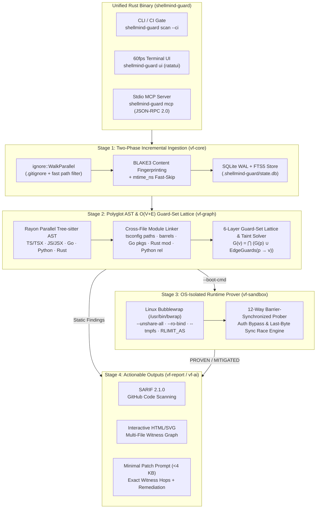

<div align="center">

# ShellMind Guard

**Compiler-Grade Multi-File Security, Business-Logic & Concurrency Verifier**

*Traces cross-file taint and guard invariants via an $O(V + E)$ Guard-Set Lattice across TypeScript, JavaScript, Go, Python, and Rust—then mathematically proves exploitability inside an unprivileged Linux Bubblewrap (`bwrap`) sandbox with zero AI API cost.*

[](https://github.com/qira-dev/ShellMind-Guard/actions/workflows/ci.yml)
[](LICENSE)
[](Cargo.toml)
[](crates/vf-sandbox)
[](src/mcp.rs)
[](crates/vf-report)

[**Architecture**](#system-architecture) · [**6-Layer Engine**](#the-6-layer-universal-verification-engine) · [**Quickstart**](#quickstart) · [**AI Agent MCP**](#model-context-protocol-shellmind-guard-mcp) · [**Benchmarks**](#verified-performance-benchmarks) · [**Blueprint**](BLUEPRINT.md)

</div>

---

## Why ShellMind Guard?

Modern software—especially high-velocity, AI-assisted full-stack codebases—suffers from vulnerabilities that span multiple files and execution layers: a route in `routes/checkout.ts` delegates to `services/ledger.ts`, which mutates a balance in `db/queries.ts` without an authentication middleware, ownership filter, or `SELECT ... FOR UPDATE` transaction lock.

Conventional security tools fail on these bugs in two predictable ways:

1. **Regex / Single-File SAST Scanners** lack cross-file call-graph and middleware-order semantics, burying engineering teams under hundreds of false positives while missing multi-hop business-logic and race-condition flaws.
2. **LLM-Only Code Scanners** burn tens of thousands of tokens per scan, hallucinate findings on sanitized paths, cannot execute deterministic data-flow proofs, and cannot verify whether a concurrency bug is actually exploitable at runtime.

**ShellMind Guard** solves both problems with a deterministic, systems-engineered architecture:

- **Two-Phase Incremental Ingestion (`BLAKE3` + `SQLite WAL`):** Fingerprints 13,000+ files at >1 GB/s, caching per-file `Tree-sitter` AST summaries in SQLite while **always re-linking the global cross-file call graph in RAM (<80 ms)** so edits to a shared middleware (`auth.ts`) immediately invalidate downstream routes (`routes.ts`).
- **$O(V + E)$ Guard-Set Lattice Solver:** Computes fixed-point security guard intersections across all incoming call paths without exponential $O(V!)$ path enumeration—terminating in linear time even on cyclic enterprise call graphs.
- **Universal 6-Layer Static & Taint Engine:** Covers hardcoded secrets, CORS/JWT/TLS/Dockerfile misconfigurations, offline lockfile advisories, cross-file SQL/Command/Path/SSRF taint with sanitizer disproof, missing auth/transaction locks, IDOR missing ownership filters, and frontend-to-backend API contract drift (`404` dead routes).
- **OS-Isolated Bubblewrap (`bwrap`) Exploit Prover:** Boots your service inside an unprivileged Linux namespace (`--unshare-all`, read-only rootfs, ephemeral `tmpfs`, 1 GiB `RLIMIT_AS` memory cap, process-group reaper) and fires barrier-synchronized **12-way Last-Byte Sync** concurrent HTTP bursts (`tokio::sync::Barrier` + `tokio::task::JoinSet`) to upgrade static `SUSPECT` findings to **`PROVEN`** or **`MITIGATED`**.
- **Native Model Context Protocol (`shellmind-guard mcp`) Server:** Exposes deterministic, zero-token-overhead security verification over `stdio` JSON-RPC 2.0 for **Claude Code, Cursor, AntiGravity, Windsurf, OpenCode, and Z-Code**.

---

## System Architecture



### Mathematical Formulation: The $O(V + E)$ Guard-Set Lattice

Instead of enumerating all simple paths between routes and sinks (which degrades to $O(V!)$ on cyclic call graphs), ShellMind Guard formulates security invariant verification as a forward data-flow monotone lattice over the finite universe of security guards $\mathcal{U} = \{\text{Auth}, \text{TxLock}, \text{OwnershipCheck}, \text{SqlSanitizer}, \text{CmdSanitizer}, \text{PathSanitizer}, \text{SsrfSanitizer}\}$:

$$\mathcal{G}_{\text{in}}(v) = \begin{cases} \emptyset & \text{if } v \in \text{EntryRoutes} \\ \displaystyle\bigcap_{p \in \text{Pred}(v)} \mathcal{G}_{\text{out}}(p) & \text{otherwise} \end{cases}, \qquad \mathcal{G}_{\text{out}}(v) = \mathcal{G}_{\text{in}}(v) \cup \text{LocalGuards}(v)$$

1. **Initialization:** Entry route nodes are initialized with their route-registration and router-level middleware guards; interior nodes start at top ($\top = \mathcal{U}$).
2. **Fixed-Point Convergence:** A worklist algorithm propagates guard sets in $O(V + E)$ time. Because $\mathcal{U}$ is finite and intersection is monotone, convergence is guaranteed on arbitrary cyclic graphs.
3. **Shortest Witness Extraction:** When a reachable sink $s$ requires guard $g \notin \mathcal{G}_{\text{out}}(s)$, a guard-avoiding multi-source BFS reconstructs the shortest unguarded witness chain $(r \to f_1 \to \dots \to s)$ in $O(V + E)$ time.

---

## The 6-Layer Universal Verification Engine

ShellMind Guard executes all 6 verification layers in a single unified pass:

| Layer | Rule ID | Severity | Category & Invariant Checked | Required Guard / Sanitizer Disproof |
| :---: | :--- | :---: | :--- | :--- |
| **1** | `VF-SEC-AWS`<br>`VF-SEC-STRIPE`<br>`VF-SEC-GITHUB`<br>`VF-SEC-OPENAI`<br>`VF-SEC-ANTHROPIC`<br>`VF-SEC-GOOGLE`<br>`VF-SEC-SLACK`<br>`VF-SEC-PRIVKEY`<br>`VF-SEC-DBURL`<br>`VF-SEC-ENTROPY` | `CRITICAL`<br>`HIGH` | **Secrets & Credential Exposure:** Provider-prefixed tokens, PEM private keys, inline credentials in `postgres://`/`mysql://`/`mongodb://`/`redis://` URLs, and Shannon entropy ($H > 4.3$) secret literals. | Excluded on lockfiles, test fixtures, example placeholders (`EXAMPLE`, `YOUR_API_KEY`, `changeme`), URLs/SQL, and non-assignment strings. |
| **1** | `VF-SEC-ENV` | `HIGH` | **Unignored `.env` File:** `.env` or `.env.production` containing live secrets is not covered by `.gitignore`. | Add `.env` / `.env.*` to `.gitignore`. |
| **1** | `VF-CFG-CORS`<br>`VF-CFG-JWT`<br>`VF-CFG-TLS`<br>`VF-CFG-DEBUG`<br>`VF-CFG-COOKIE`<br>`VF-CFG-DOCKER` | `CRITICAL`<br>`HIGH`<br>`MEDIUM` | **Security Misconfigurations:** Wildcard CORS (`origin: "*"`) with `credentials: true`, hardcoded JWT secrets or `alg: "none"`, `NODE_TLS_REJECT_UNAUTHORIZED=0` / `InsecureSkipVerify: true` / `verify=False`, production `DEBUG=True`, insecure session cookies, and `Dockerfile` missing non-root `USER`. | Restrict CORS origins, load secrets from env, keep TLS verification enabled, enforce `httpOnly: true, secure: true`, add `USER <non-root>`. |
| **2** | `VF-DEP-001` | `HIGH`<br>`MEDIUM` | **Offline-First Dependency & Lockfile Audit:** Parses `package.json`, `package-lock.json`, `Cargo.toml`, `Cargo.lock`, `go.mod`, and `requirements.txt` for unpinned `*`/`latest` versions, `http://` tarball registries, and embedded high-risk advisories. | Pin deterministic semver ranges and upgrade affected packages (zero external network calls). |
| **3** | `VF-SQLI-001` | `CRITICAL` | **Cross-File SQL Injection:** Untrusted HTTP input (`req.query`, `req.params`, `req.body`, `c.Query`, `r.URL.Query`, FastAPI/NestJS route params) flows into dynamic SQL (`${...}`, `fmt.Sprintf`, `f"SELECT..."`, `%`, `+`, `.concat()`). | Parameterized queries (`$1`, `?`), safe tagged templates (`prisma.$queryRaw\`...\``), or integer/UUID/Zod parsers (`strconv.Atoi`, `parseInt`, `z.object`). |
| **3** | `VF-CMDI-001` | `CRITICAL` | **Command Injection:** Tainted input reaches `exec`, `execSync`, `spawn(..., { shell: true })`, `os.system`, `subprocess.run(..., shell=True)`, `exec.Command("sh", "-c", ...)`, or `Command::new("sh")`. | Argument array execution without shell, `shlex.quote`, `shellEscape`, or strict allowlist/numeric parser. |
| **3** | `VF-PATH-001` | `HIGH` | **Path Traversal:** Tainted input reaches `fs.readFile`, `fs.writeFile`, `res.sendFile`, `os.Open`, `os.ReadFile`, `http.ServeFile`, `open()`, or `std::fs::read`. | `path.basename`, `filepath.Base`, `filepath.Clean` + `.startsWith(baseDir)` prefix check. |
| **3** | `VF-SSRF-001` | `HIGH` | **Server-Side Request Forgery (SSRF):** Tainted URL reaches `fetch`, `axios`, `http.Get`, `requests.get`, `httpx.get`, or `reqwest::get`. | Explicit hostname allowlist (`allowedHosts`, `validateUrl`) and private/link-local CIDR block. |
| **4** | `VF-AUTH-001` | `HIGH` | **Missing Authentication Guard:** Reachable path from an HTTP route to a privileged state-mutating sink (`PaymentMutation`, `BalanceUpdate`, `SqlWrite`, `AuthMutation`, `ResourceDestroy`) without an active `Auth` guard. | Route/router middleware (`requireAuth`, `UseGuards`, `protectedProcedure`, `login_required`, `AuthMiddleware`) or `.shellmind-guard.toml` `public_routes`. |
| **4** | `VF-IDOR-001` | `HIGH` | **Insecure Direct Object Reference (IDOR):** Authenticated route accepts a resource ID (`:id`, `{id}`, `[id]`) and executes a DB read/update/delete (`prisma.*.delete`, `db.*.findUnique`, `SELECT/UPDATE/DELETE WHERE id = ...`) without scoping by caller identity. | Include caller ownership predicate (`user_id = req.user.id`, `owner_id`, `tenant_id`, `org_id`, `current_user`). |
| **5** | `VF-RACE-001` | `CRITICAL` | **Concurrency / Double-Spend Race:** Payment or balance/wallet mutation reachable without an enclosing ACID transaction lock or idempotency guard—proven at runtime via 12 concurrent barrier-synchronized requests. | `withTransaction`, `SELECT ... FOR UPDATE`, `db.Transaction`, `BeginTx`, `$transaction`, or atomic `idempotencyKey`. |
| **6** | `VF-FE-404`<br>`VF-FE-ERR` | `MEDIUM`<br>`LOW` | **Frontend ↔ Backend Contract & UI Integrity:** Frontend `fetch('/api/...')` / `axios.<method>('/api/...')` calling a path that matches no backend route (`VF-FE-404`), dead `onClick={() => {}}` handlers, or unhandled async `fetch`/`axios` calls without `try/catch` or `.catch()`. | Align frontend API paths with backend routes (including mounted prefixes) and handle async rejection states. |

### Supported Languages & Frameworks

| Language | AST Grammar | Frameworks & Idioms Extracted Automatically |
| :--- | :--- | :--- |
| **TypeScript / JavaScript** (`.ts`, `.tsx`, `.js`, `.jsx`, `.mjs`, `.cjs`) | `tree-sitter-typescript` (TS & TSX), `tree-sitter-javascript` | Express, Fastify, Hono, Koa, **Next.js App Router** (`export async function GET/POST/PUT/DELETE/PATCH`), **NestJS** (`@Controller`, `@Get`/`@Post`, `@UseGuards`), **tRPC** (`publicProcedure`, `protectedProcedure`), Prisma, Drizzle, React/Next.js Frontend (`fetch`, `axios`) |
| **Go** (`.go`) | `tree-sitter-go` | `net/http` (`http.HandleFunc`, `mux.HandleFunc`), **Gin** (`r.GET`, `r.Group`, `.Use`), **Echo**, **Chi**, `database/sql` (`db.Query`, `db.Exec`, `tx.Exec`), `os/exec` |
| **Python** (`.py`) | `tree-sitter-python` | **FastAPI** (`@app.get`, `@router.post`, `Depends`), **Flask** (`@app.route`, `request.args`), **Django** (`path()`, `@login_required`, `.objects.get/filter`), `cursor.execute`, `subprocess` |
| **Rust** (`.rs`) | `tree-sitter-rust` | **Axum** (`Router::new().route()`, `.layer()`), **Actix-Web** (`#[get("/...")]`, `#[post("/...")]`, `web::Path`, `web::Query`), `sqlx`, `tokio::process::Command` |

---

## Verified Performance Benchmarks

Measured on a 4-Core Linux workstation (Ubuntu Wayland, 15 GiB RAM, NVMe SSD, 12 MB stripped release binary):

| Workload | Scope | Cold Scan | Warm Cached Scan | Notes |
| :--- | :--- | :---: | :---: | :--- |
| **Enterprise TypeScript Monorepo** | 575 directories / **13,225 `.ts` files** | **414 ms** | **195 ms** | Full walk + `BLAKE3` + `Tree-sitter` + $O(V+E)$ Lattice (Warm Delta Index: **76 ms**) |
| **2,000-Node Cyclic Sink Chain** | Stress test (`test_b11_2000_node_all_sink_chain_is_linear`) | **< 15 ms** | **< 5 ms** | Proves linear $O(V + E)$ scaling without path explosion |
| **Polyglot 6-Layer Suite** | TS + TSX + Go + Python + Dockerfile + `package.json` + `.env` | **19 ms** | **3 ms** | Detects all 14 rule families across all 6 layers |
| **MCP `shellmind_guard_scan` Tool Call** | JSON-RPC 2.0 `stdio` round-trip | **19 ms** | **4 ms** | Zero LLM token overhead |

---

## Quickstart

### 1. One-Command Install (No Rust Toolchain Required)

**Linux & macOS:**
```bash
curl -fsSL https://raw.githubusercontent.com/qira-dev/ShellMind-Guard/main/install.sh | bash
```

**Windows (PowerShell):**
```powershell
irm https://raw.githubusercontent.com/qira-dev/ShellMind-Guard/main/install.ps1 | iex
```

**Load as an AI Coding Plugin (Claude Code / MCP + Skills + Commit Hook):**
```bash
claude --plugin-dir /path/to/ShellMind-Guard
```

### 2. Build & Install from Source

```bash
git clone https://github.com/qira-dev/ShellMind-Guard.git
cd ShellMind Guard

# Install the optimized release binary to ~/.cargo/bin/shellmind-guard
cargo install --path .
```

> **Optional Runtime Prover Dependency:** Install `bubblewrap` (`sudo apt install bubblewrap` on Debian/Ubuntu or `sudo dnf install bubblewrap` on Fedora) to enable OS-isolated `--boot-cmd` exploit verification. Static 6-layer verification works everywhere with zero external dependencies.

### 2. Initialize a Project & CI Gate

```bash
# Auto-detect project stack, write .shellmind-guard.toml, and generate .github/workflows/shellmind-guard.yml
shellmind-guard init /path/to/your/repo --ci
```

### 3. Run a Full 6-Layer Scan

```bash
# Human-readable terminal report
shellmind-guard scan /path/to/your/repo

# Machine-readable JSON or SARIF 2.1.0 report
shellmind-guard scan /path/to/your/repo --format json
shellmind-guard scan /path/to/your/repo --format sarif

# Filter specific layers or rule families
shellmind-guard scan /path/to/your/repo --layers secrets,sqli,idor,race
```

### 4. Prove Exploits in the Isolated Bubblewrap Sandbox

Run ShellMind Guard against the included vulnerable Node/TypeScript payment fixture (`fixtures/vuln-payment-node`) to see static `SUSPECT` findings upgraded to **`PROVEN`** via live sandbox execution and 12-way barrier-synchronized race probing:

```bash
shellmind-guard scan fixtures/vuln-payment-node \
  --boot-cmd "node server.mjs" \
  --sarif .shellmind-guard/report.sarif \
  --html .shellmind-guard/report.html
```

Sample output:

```text
ShellMind Guard Scan | 5 files (14 symbols, 5 edges, 3 routes) | 42ms (delta: +5 / 0 cached)
  [!] 5 finding(s) detected:

  [HIGH] VF-AUTH-001 (VF-AUTH-001) -> Unauthenticated path to BalanceUpdate in `debitBalance`
      Entry: POST /api/v1/checkout/withdraw
      [1] src/routes/checkout.ts:8  POST /api/v1/checkout/withdraw
      [2] src/services/ledger.ts:3  processWithdrawal
      [3] src/db/queries.ts:1       debitBalance

  [CRITICAL] VF-RACE-002 (VF-RACE-001) -> Missing transaction/lock guard before `debitBalance` (Double-Spend Risk)
      Entry: POST /api/v1/checkout/withdraw
      [1] src/routes/checkout.ts:8  POST /api/v1/checkout/withdraw
      [2] src/services/ledger.ts:3  processWithdrawal
      [3] src/db/queries.ts:1       debitBalance

ShellMind Guard Sandbox Proof (bwrap=isolated):
  [PROVEN] VF-AUTH-001 (VF-AUTH-001) -> Unauthenticated POST /api/v1/checkout/withdraw returned HTTP 200 (body: {"ok":true,...})
  [PROVEN] VF-RACE-002 (VF-RACE-001) -> 12/12 concurrent requests returned HTTP 200 (Last-Byte Sync, 1 distinct bodies)
```

### 5. Replay a Single Finding & Generate a Minimal (<4 KB) Patch Prompt

```bash
shellmind-guard replay VF-RACE-002 fixtures/vuln-payment-node \
  --boot-cmd "node server.mjs" \
  --patch
```

### 6. Launch the Panic-Safe 60fps Terminal UI (`ratatui`)

```bash
shellmind-guard ui fixtures/vuln-payment-node --boot-cmd "node server.mjs"
```

- **`[j]` / `[k]` or `↑` / `↓`:** Navigate findings across all 6 layers
- **`[Enter]`:** Re-run live Bubblewrap sandbox PoC for the selected finding
- **`[p]`:** Generate minimal (<4 KB) multi-file witness patch prompt
- **`[g]` / `[s]`:** Export interactive Carbon-Slate HTML/SVG graph and SARIF 2.1.0 report
- **`[L]`:** Toggle internal sandbox & diagnostics ring-buffer drawer (zero stdout corruption)

---

## Model Context Protocol (`shellmind-guard mcp`)

ShellMind Guard includes a built-in, newline-delimited **JSON-RPC 2.0 Stdio MCP Server** (`shellmind-guard mcp`) so AI coding agents (**Claude Code, Cursor, AntiGravity, Windsurf, OpenCode, Z-Code**) can run deterministic multi-file security verification without burning context tokens on raw file reads.

### Add ShellMind Guard to Your AI Agent (`mcpServers` Config)

Add the following to your `.mcp.json`, `~/.claude.json`, or `.cursor/mcp.json`:

```json
{
  "mcpServers": {
    "shellmind-guard": {
      "command": "shellmind-guard",
      "args": ["mcp"]
    }
  }
}
```

### Exposed MCP Tools

| Tool Name | Input Schema | Description |
| :--- | :--- | :--- |
| `shellmind_guard_scan` | `{ "path"?: string, "layers"?: string[], "boot_cmd"?: string }` | Runs the full 6-layer AST + Guard-Set Lattice scan (and optional `bwrap` sandbox proof) and returns structured JSON findings with witness hops and remediation. |
| `shellmind_guard_explain_finding` | `{ "path"?: string, "finding_id": string }` | Resolves a finding by `id` (e.g. `VF-RACE-002`) or `rule_id` (e.g. `VF-SQLI-001`) and returns exact source lines around every hop in `witness_path`, a<4 KB patch prompt, and concrete remediation guidance. |
| `shellmind_guard_init` | `{ "path"?: string, "ci"?: boolean }` | Detects the repository language stack, writes `.shellmind-guard.toml`, and optionally scaffolds `.github/workflows/shellmind-guard.yml`. |

---

## Configuration (`.shellmind-guard.toml`)

ShellMind Guard works out of the box with zero configuration, or can be customized via `.shellmind-guard.toml` in your repository root:

```toml
[guards]
# Functions, decorators, or middleware identifiers treated as authentication guards
auth_guards = [
  "requireAuth", "authenticate", "verifyJwt", "withAuth", "requireAdmin",
  "ensureAuthenticated", "AuthGuard", "UseGuards", "protectedProcedure",
  "login_required", "AuthMiddleware"
]

# Wrappers or SQL clauses treated as concurrency / transaction lock guards
lock_guards = [
  "withTransaction", "FOR UPDATE", "acquireLock", "idempotencyKey",
  "BeginTx", "db.Transaction", "$transaction"
]

# Intentionally unauthenticated routes (suppresses VF-AUTH-001 only; never suppresses SQLi/CMDi/Race)
public_routes = [
  "/health", "/healthz", "/readyz", "/metrics",
  "/login", "/register", "/signup", "/webhook"
]

# Custom router registration methods (if your framework wraps standard HTTP verbs)
custom_routes = []

[scan]
ignore_paths = ["node_modules", "target", "dist", "build", ".next", ".shellmind-guard"]
max_threads = 4
max_file_bytes = 2097152

[sandbox]
# Default boot command for `shellmind-guard scan`, `shellmind-guard replay`, and `shellmind-guard ui`
# boot_cmd = "node server.mjs"
```

---

## Workspace Architecture

ShellMind Guard is organized as a modular, 100% pure-Rust Cargo workspace:

```text
ShellMind Guard/
├── Cargo.toml                     # Workspace root (Rust 2024 Edition)
├── src/
│   ├── main.rs                    # Unified CLI (`init`, `index`, `scan`, `replay`, `ui`, `mcp`)
│   └── mcp.rs                     # Stdio JSON-RPC 2.0 Model Context Protocol server
├── crates/
│   ├── vf-core/                   # .shellmind-guard.toml config, ignore::WalkParallel + BLAKE3 scanner,
│   │                              # SQLite WAL + FTS5 Two-Phase AST & findings store
│   ├── vf-graph/                  # Parallel Tree-sitter AST (TS/JS/Go/Python/Rust), cross-file
│   │                              # module resolver, 6-layer taint engine & O(V+E) Guard-Set Lattice
│   ├── vf-sandbox/                # Linux Bubblewrap (--unshare-all) runner, inner namespace probe,
│   │                              # 12-way Barrier + JoinSet concurrent race & auth verifier
│   ├── vf-report/                 # SARIF 2.1.0 & self-contained Carbon-Slate HTML/SVG graph exporter
│   ├── vf-tui/                    # Panic-safe 60fps ratatui 3-pane workspace + ring-buffer log drawer
│   └── vf-ai/                     # Opt-in minimal-context (<4 KB) witness patch prompt builder
└── fixtures/
    ├── vuln-payment-node/         # Runnable multi-file Node/TS double-spend race, SQLi & auth fixture
    └── vuln-auth-rust/            # Multi-file Rust Axum unauthenticated role-mutation fixture
```

Further engineering documentation:
- [**`BLUEPRINT.md`**](BLUEPRINT.md) — Master System Architecture, Lattice Mathematics & Sandbox Isolation Spec
- [**`PLANNING.md`**](PLANNING.md) — Module Specifications, Crate Stack & Engineering Risk Matrix
- [**`ROADMAP.md`**](ROADMAP.md) — Phase-by-Phase Engineering Milestones & Verification Gates
- [**`SECURITY.md`**](SECURITY.md) — Sandbox Isolation Model & Vulnerability Disclosure Policy
- [**`CONTRIBUTING.md`**](CONTRIBUTING.md) — Architecture Invariants & Developer Contribution Guide
- [**`CHANGELOG.md`**](CHANGELOG.md) — Release History

---

## License

Licensed under the [Apache License, Version 2.0](LICENSE).
