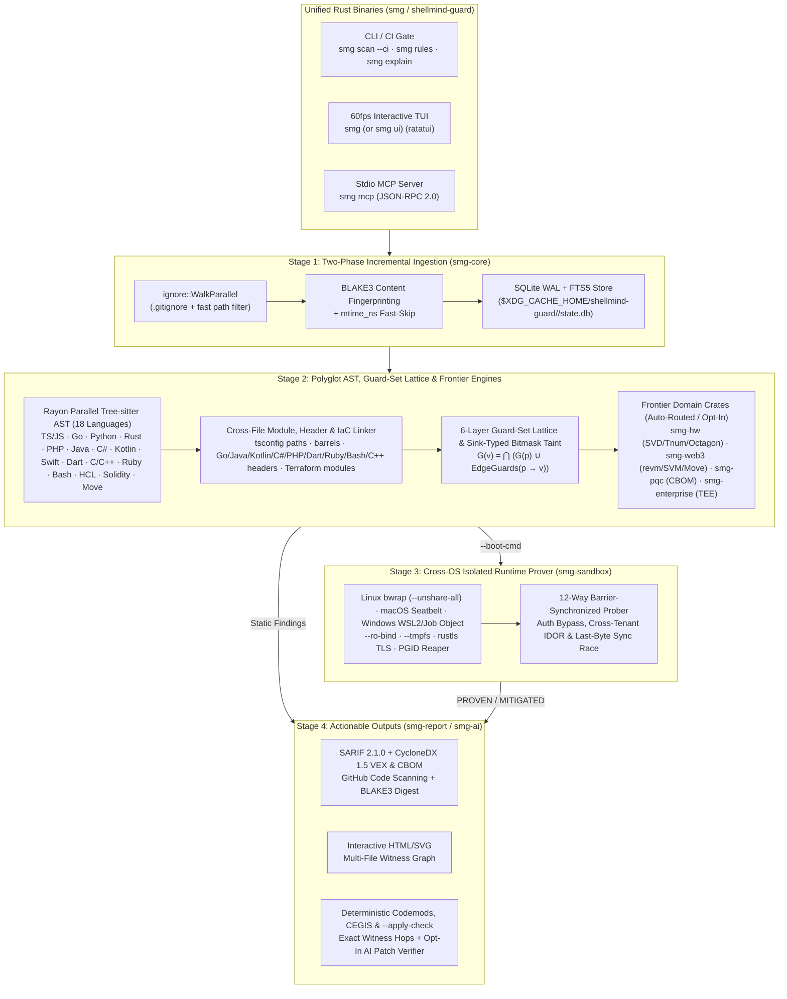

<div align="center">

<picture>
  <source media="(prefers-color-scheme: dark)" srcset="assets/wordmark-dark.svg">
  <source media="(prefers-color-scheme: light)" srcset="assets/wordmark-light.svg">
  
</picture>

**Compiler-Grade Multi-File Security, Business-Logic, Concurrency & Frontier Domain Verifier**

*Traces cross-file taint and guard invariants via an $O(V + E)$ Guard-Set Lattice across 18 languages & ecosystems (TypeScript, JavaScript, Go, Python, Rust, PHP, Java, C#, Kotlin, Swift, Dart, C, C++, Ruby, Bash/Shell, Terraform/HCL, Solidity, and Move)—plus isolated Hardware/Firmware (`smg-hw`), Web3 + `revm` Concrete Oracle (`smg-web3`), Post-Quantum Crypto-Agility (`smg-pqc`), and Confidential TEE (`smg-enterprise`) verification—then proves exploitability inside an isolated Cross-OS sandbox (`Linux bwrap`, `macOS sandbox-exec`, `Windows WSL2/Job Object`) with zero AI API cost.*

[](https://github.com/qira-dev/ShellMind-Guard/actions/workflows/ci.yml)
[](LICENSE)
[](Cargo.toml)
[](crates/smg-sandbox)
[](#frontier-verification-domains-hw--web3--pqc--enterprise)
[](src/mcp.rs)
[](crates/smg-report)

[**Architecture**](#system-architecture) · [**6-Layer Engine**](#the-6-layer-universal-verification-engine) · [**Frontier Domains**](#frontier-verification-domains-hw--web3--pqc--enterprise) · [**Quickstart**](#quickstart) · [**AI Agent MCP**](#model-context-protocol-shellmind-guard-mcp) · [**Benchmarks**](#verified-performance-benchmarks) · [**Blueprint**](BLUEPRINT.md)

</div>

---

## Why ShellMind Guard?

Modern software—especially high-velocity, AI-assisted full-stack codebases—suffers from vulnerabilities that span multiple files and execution layers: a route in `routes/checkout.ts` delegates to `services/ledger.ts`, which mutates a balance in `db/queries.ts` without an authentication middleware, ownership filter, or `SELECT ... FOR UPDATE` transaction lock.

Conventional security tools fail on these bugs in two predictable ways:

1. **Regex / Single-File SAST Scanners** lack cross-file call-graph and middleware-order semantics, burying engineering teams under hundreds of false positives while missing multi-hop business-logic and race-condition flaws.
2. **LLM-Only Code Scanners** burn tens of thousands of tokens per scan, hallucinate findings on sanitized paths, cannot execute deterministic data-flow proofs, and cannot verify whether a concurrency bug is actually exploitable at runtime.

**ShellMind Guard** solves both problems with a deterministic, systems-engineered architecture:

- **Two-Phase Incremental Ingestion (`BLAKE3` + `SQLite WAL`):** Fingerprints 13,000+ files at >1 GB/s, caching per-file `Tree-sitter` AST summaries in SQLite while **always re-linking the global cross-file call graph in RAM (<80 ms)** so edits to a shared middleware (`auth.ts`) immediately invalidate downstream routes (`routes.ts`).
- **$O(V + E)$ Guard-Set Lattice Solver:** Computes fixed-point security guard intersections across all incoming call paths without exponential $O(V!)$ path enumeration—terminating in linear time even on cyclic enterprise call graphs.
- **Universal 6-Layer Static & Taint Engine:** Covers hardcoded secrets, CORS/JWT/TLS/Dockerfile misconfigurations, offline lockfile advisories, cross-file SQL/Command/Path/SSRF taint with sanitizer disproof, missing auth/transaction locks, IDOR missing ownership filters, and frontend-to-backend API contract drift (`404` dead routes).
- **Cross-OS Isolated Exploit Prover (`smg-sandbox`):** Boots your service inside an isolated OS sandbox (**Linux `bwrap` `--unshare-all`**, **macOS `sandbox-exec` Seatbelt**, or **Windows WSL2 `bwrap` + Win32 Job Object** with optional `--sandbox-mem-mb` `RLIMIT_AS` / `--cgroup-v2`, `--sandbox-tls` loopback `rustls`, `--mock-shims`, fast `UNBOOTABLE` diagnostics, and process-group reaper) and fires barrier-synchronized **12-way Last-Byte Sync** concurrent HTTP/HTTPS bursts (`tokio::sync::Barrier` + `tokio::task::JoinSet`) to upgrade static `SUSPECT` findings to **`PROVEN`** or **`MITIGATED`**.
- **Isolated Frontier Verification Domains (`hw` · `web3` · `pqc` · `enterprise`):** Zero-overhead on standard Web/AppSec repos—auto-activates `smg-hw` (`Tnum`/`SparseOctagon`/CMSIS-SVD/IRQ) on firmware/kernel code and `smg-web3` (`tree-sitter-solidity`, Foundry/Hardhat, in-process **`revm` v43.0.3** concrete EVM oracle, Solana Anchor, Sui/Aptos Move) on Web3 repos, plus opt-in `smg-pqc` (Shor/Grover/BHT, Mosca HNDL, CycloneDX 1.5 Static CBOM) and `smg-enterprise` (Ed25519 license pinning & Nitro/TDX/SEV-SNP remote TEE attestation).
- **Native Model Context Protocol (`shellmind-guard mcp`) Server:** Exposes deterministic, zero-token-overhead security verification over `stdio` JSON-RPC 2.0 for **Claude Code, Cursor, AntiGravity, Windsurf, OpenCode, and Z-Code**.

---

## System Architecture



### Mathematical Formulation: The $O(V + E)$ Guard-Set Lattice

Instead of enumerating all simple paths between routes and sinks (which degrades to $O(V!)$ on cyclic call graphs), ShellMind Guard formulates security invariant verification as a forward data-flow monotone lattice over the finite universe of security guards $\mathcal{U} = \{\text{Auth}, \text{TxLock}, \text{OwnershipCheck}, \text{SqlSanitizer}, \text{CmdSanitizer}, \text{PathSanitizer}, \text{SsrfSanitizer}, \text{XssSanitizer}, \text{CsrfProtection}\}$ paired with a sink-typed bitmask taint semilattice (preventing cross-sink sanitizer confusion) and explicit finding confidence grading (`PROVEN`, `CONFIRMED`, `HEURISTIC`):

$$\mathcal{G}_{\text{in}}(v) = \begin{cases} \emptyset & \text{if } v \in \text{EntryRoutes} \\ \displaystyle\bigcap_{p \in \text{Pred}(v)} \mathcal{G}_{\text{out}}(p) & \text{otherwise} \end{cases}, \qquad \mathcal{G}_{\text{out}}(v) = \mathcal{G}_{\text{in}}(v) \cup \text{LocalGuards}(v)$$

1. **Initialization:** Entry route nodes are initialized with their route-registration and router-level middleware guards; interior nodes start at top ($\top = \mathcal{U}$).
2. **Fixed-Point Convergence:** A worklist algorithm propagates guard sets in $O(V + E)$ time. Because $\mathcal{U}$ is finite and intersection is monotone, convergence is guaranteed on arbitrary cyclic graphs.
3. **Shortest Witness Extraction:** When a reachable sink $s$ requires guard $g \notin \mathcal{G}_{\text{out}}(s)$, a guard-avoiding multi-source BFS reconstructs the shortest unguarded witness chain $(r \to f_1 \to \dots \to s)$ in $O(V + E)$ time.

---

## The 6-Layer Universal Verification Engine

ShellMind Guard executes all 6 verification layers in a single unified pass:

| Layer | Rule ID | Severity | Category & Invariant Checked | Required Guard / Sanitizer Disproof |
| :---: | :--- | :---: | :--- | :--- |
| **1** | `SMG-SEC-AWS`<br>`SMG-SEC-STRIPE`<br>`SMG-SEC-GITHUB`<br>`SMG-SEC-OPENAI`<br>`SMG-SEC-ANTHROPIC`<br>`SMG-SEC-GOOGLE`<br>`SMG-SEC-SLACK`<br>`SMG-SEC-JWT`<br>`SMG-SEC-PRIVKEY`<br>`SMG-SEC-DBURL`<br>`SMG-SEC-CLIENT-ENV`<br>`SMG-SEC-ENTROPY` | `CRITICAL`<br>`HIGH` | **Secrets & Credential Exposure:** Provider-prefixed tokens, hardcoded JWT secrets (`SMG-SEC-JWT`), PEM private keys, inline credentials in `postgres://`/`mysql://`/`mongodb://`/`redis://` URLs, private secrets exposed in public frontend bundles (`NEXT_PUBLIC_*`, `VITE_*`, `REACT_APP_*`, `NUXT_PUBLIC_*`), and Shannon entropy ($H > 4.3$) secret literals. | Excluded on lockfiles, test fixtures, example placeholders (`EXAMPLE`, `YOUR_API_KEY`, `changeme`), URLs/SQL, and non-assignment strings. |
| **1** | `SMG-SEC-ENV` | `HIGH` | **Unignored `.env` File:** `.env` or `.env.production` containing live secrets is not covered by `.gitignore`. | Add `.env` / `.env.*` to `.gitignore`. |
| **1** | `SMG-CFG-CORS`<br>`SMG-CFG-JWT-LOGIC`<br>`SMG-CFG-TLS`<br>`SMG-CFG-DEBUG`<br>`SMG-CFG-COOKIE`<br>`SMG-CFG-DOCKER`<br>`SMG-CFG-PROTO`<br>`SMG-CFG-XXE`<br>`SMG-CFG-SQL-EXEC`<br>`SMG-CFG-SQL-SEARCHPATH`<br>`SMG-CFG-SQL-RLS`<br>`SMG-CFG-SQL-PRIV` | `CRITICAL`<br>`HIGH`<br>`MEDIUM` | **Security Misconfigurations & SQL Schema Policies:** Wildcard CORS (`origin: "*"`) with `credentials: true`, JWT bypasses (`alg: "none"`, `verify_signature: False`, unverified `jwt.decode`, weak hardcoded JWT secrets), TLS disabled, `DEBUG=True`, insecure cookies, non-root `USER`-less `Dockerfile`, JavaScript prototype pollution (`__proto__`/`constructor.prototype`), unsafe XML/XXE parsers, and `.sql` migration hazards (dynamic `EXECUTE format('%s')`, `SECURITY DEFINER` missing `SET search_path`, `DISABLE ROW LEVEL SECURITY`, `SUPERUSER`/over-privileged grants). | Restrict CORS, enforce strong verified JWT secrets/algorithms, keep TLS checks on, sanitize keys against `__proto__`, disable XML external entities/DTDs, and harden `.sql` procedures/grants. |
| **2** | `SMG-DEP-001` | `HIGH`<br>`MEDIUM` | **Offline-First Dependency & Lockfile Audit:** Parses `package.json`, `package-lock.json`, `Cargo.toml`, `Cargo.lock`, `go.mod`, `requirements.txt`, `pyproject.toml`, `poetry.lock`, and `uv.lock` for unpinned `*`/`latest` versions, `http://` tarball registries, embedded high-risk advisories, and local SQLite OSV advisory index (`$XDG_CACHE_HOME/shellmind-guard/advisories.db`) synced opt-in via `smg deps sync`. | Pin deterministic semver ranges and upgrade affected packages (scans stay 100% offline with zero network calls). |
| **3** | `SMG-SQLI-001`<br>`SMG-SQLI-NOSQL`<br>`SMG-SQLI-MASS` | `CRITICAL`<br>`HIGH` | **Cross-File SQL, NoSQL & ORM Injection:** Untrusted HTTP input flows into dynamic SQL (`knex.raw`, `sequelize.query`, `queryRunner.query`, `sql.unsafe`, `db.prepare`, `Fmt`/`f""`/`${...}`), MongoDB queries (`find`/`aggregate`/`$where`/`$function`/`$regex`) or Redis Lua `eval`/`evalsha`, or unvalidated ORM mass assignment (`prisma.create({ data: req.body })`, `bulkCreate`). | Parameterized queries (`$1`, `?`), safe tagged templates (`prisma.$queryRaw\`...\``), `$eq` / strict Zod/integer/UUID allowlists, and explicit field picking. |
| **3** | `SMG-XSS-001` | `HIGH` | **Cross-Site Scripting (XSS):** Untrusted HTTP or DOM URL input (`window.location.search`, `window.location.hash`, `URLSearchParams`) flows into `dangerouslySetInnerHTML`, `innerHTML`, `res.send`/`html` responses, `template.HTML(...)`, or Python `Markup(...)`/`render_template_string` without an XSS sanitizer bit. | HTML escaping/sanitization (`DOMPurify.sanitize`, `bluemonday`, `bleach.clean`, `ammonia::clean`, `html.escape`) matching the XSS sink bit. |
| **3** | `SMG-CMDI-001`<br>`SMG-CMDI-SSTI`<br>`SMG-CMDI-DESER` | `CRITICAL` | **Command, SSTI & Deserialization Execution:** Tainted input reaches `exec`/`os.system`/`subprocess.run(..., shell=True)`/`exec.Command`, unsafe template rendering (SSTI), or unsafe deserialization (`pickle.loads`, `yaml.load`, `unserialize`, `ObjectInputStream`). | Argument array execution without shell, `shlex.quote`, `yaml.safe_load`/JSON schemas, or strict allowlist/numeric parser. |
| **3** | `SMG-PATH-001` | `HIGH` | **Path Traversal:** Tainted input reaches `fs.readFile`, `fs.writeFile`, `res.sendFile`, `os.Open`, `os.ReadFile`, `http.ServeFile`, `open()`, or `std::fs::read`. | `path.basename`, `filepath.Base`, `filepath.Clean` + `.startsWith(baseDir)` prefix check. |
| **3** | `SMG-SSRF-001`<br>`SMG-SSRF-REDIRECT` | `HIGH` | **SSRF & Open Redirect:** Tainted URL reaches `fetch`, `axios`, `http.Get`, `requests.get`, `httpx.get`, `reqwest::get`, or unvalidated server/DOM redirects (`window.location.href`, `window.open`, `res.redirect`). | Explicit hostname allowlist (`allowedHosts`, `validateUrl`), scheme validation, and private/link-local CIDR block. |
| **4** | `SMG-AUTH-001` | `HIGH` | **Missing Authentication Guard:** Reachable path from an HTTP route to a privileged state-mutating sink (`PaymentMutation`, `BalanceUpdate`, `SqlWrite`, `AuthMutation`, `ResourceDestroy`) without an active `Auth` guard. | Route/router middleware (`requireAuth`, `UseGuards`, `protectedProcedure`, `login_required`, `AuthMiddleware`) or `.shellmind-guard.toml` `public_routes`. |
| **4** | `SMG-CSRF-001` | `HIGH` | **Cross-Site Request Forgery (CSRF):** Cookie/session-authenticated state-changing endpoints or explicit `@csrf_exempt` overrides without CSRF token middleware or `SameSite` cookie protection (excludes pure Bearer/JWT APIs, webhooks, and health probes). | `csurf` / `csrfProtect` / `SameSite=Strict` or `SameSite=Lax` cookies, or token-based `Authorization: Bearer` auth. |
| **4** | `SMG-IDOR-001` | `HIGH` | **Insecure Direct Object Reference (IDOR):** Authenticated route accepts a resource ID (`:id`, `{id}`, `[id]`) and executes a DB read/update/delete without scoping by caller identity—provable dynamically via User A vs User B sandbox probing. | Include caller ownership predicate (`user_id = req.user.id`, `owner_id`, `tenant_id`, `org_id`, `current_user`) and verify HTTP `401/403/404` across tenants. |
| **5** | `SMG-RACE-001`<br>`SMG-ENG-DEADLOCK`<br>`SMG-ENG-LEAK`<br>`SMG-MEM-BOUNDS`<br>`SMG-ENG-INT` | `CRITICAL`<br>`HIGH` | **Concurrency, Resource Leaks & Native Memory Safety:** Payment/balance double-spend races (`SMG-RACE-001`), cross-function `A->B / B->A` lock-order inversions & sync locks held across `.await` (`SMG-ENG-DEADLOCK`), unclosed file/socket/DB handles on early error returns (`SMG-ENG-LEAK`), unbounded C/C++ copies (`strcpy`, `sprintf`, unchecked `memcpy`) & unguarded Rust `unsafe` slice/ptr access (`SMG-MEM-BOUNDS`), and allocation integer overflow (`SMG-ENG-INT`). | Enforce `withTransaction`/`SELECT ... FOR UPDATE`, canonical lock ordering (`std::scoped_lock`), drop mutexes before `.await`, use RAII/`defer`/`try-finally`, and validate bounds + checked arithmetic. |
| **6** | `SMG-FE-404`<br>`SMG-FE-ERR`<br>`SMG-FE-STORAGE`<br>`SMG-FE-MSG`<br>`SMG-FE-TABNAB` | `HIGH`<br>`MEDIUM`<br>`LOW` | **Frontend ↔ Backend Contract & Browser Security:** Frontend `fetch`/`axios`/`$fetch`/`useFetch`/`this.http.*` calling missing backend routes (`SMG-FE-404`), dead `onClick` or unhandled async fetches (`SMG-FE-ERR`), auth tokens/secrets persisted in `localStorage`/`sessionStorage` (`SMG-FE-STORAGE`), unverified `postMessage` (`*` target origin or `.data` without `.origin` check, `SMG-FE-MSG`), and `target="_blank"` missing `noopener` (`SMG-FE-TABNAB`). | Align API contracts, handle rejections, store tokens in `httpOnly` cookies, enforce strict `event.origin` checks, and add `rel="noopener noreferrer"`. |
| **Domain** | `SMG-MOB-STORAGE`<br>`SMG-MOB-IPC`<br>`SMG-MOB-TLS` | `CRITICAL`<br>`HIGH`<br>`MEDIUM` | **Domain-Routed Mobile Security (`Android`/`iOS`/`Flutter`):** Activated automatically when mobile code/manifests (`AndroidManifest.xml`, `Info.plist`, `pubspec.yaml`) exist: plaintext `SharedPreferences` / `UserDefaults` credential storage (`SMG-MOB-STORAGE`), exported permissionless Android components / dynamic receivers / WebView bridges (`SMG-MOB-IPC`), and trust-all TLS verifiers / ATS bypasses (`SMG-MOB-TLS`). | Use `EncryptedSharedPreferences`/Keychain/`FlutterSecureStorage`, enforce `android:exported="false"` or signature permissions, and enable strict TLS pinning. |
| **Deep (`--deep`)** | `SMG-FUZZ-SCHEMA`<br>`SMG-FUZZ-TAMPER`<br>`SMG-FUZZ-CRASH`<br>`SMG-FUZZ-ENCODING` | `CRITICAL`<br>`HIGH` | **Schema Bounds & Targeted Route Fuzzing (`--deep`):** Extracts route schemas from AST handlers and OpenAPI/Swagger specs to flag unvalidated financial/quantity parameters (`SMG-FUZZ-SCHEMA`) and probe live sandboxed routes for negative/zero tampering (`SMG-FUZZ-TAMPER`), server 5xx/panic crashes (`SMG-FUZZ-CRASH`), and null-byte / invalid UTF-8 (`\xff\xfe`) failures (`SMG-FUZZ-ENCODING`). | Enforce finite positive schema validation (`amount > 0`, Zod `.finite().positive()`, Pydantic `gt=0`) and reject malformed/non-UTF-8 payloads with `400/422`. |

---

## Frontier Verification Domains (`hw` · `web3` · `pqc` · `enterprise`)

Built as isolated, feature-gated workspace crates (`default = ["hw", "web3", "pqc", "enterprise"]`) with **zero latency overhead** on standard Web/AppSec repositories:

| Crate / Flag | Rule IDs | Severity | Mathematical / Execution Engine | Required Guard / Proof Tier |
| :--- | :--- | :---: | :--- | :--- |
| **`smg-hw`**<br>`--layers hw` | `SMG-HW-MMIO`, `SMG-HW-BOUNDS`, `SMG-HW-TOCTOU`, `SMG-HW-IRQ`, `SMG-HW-TYPESTATE`, `SMG-HW-BOOT`, `SMG-HW-CT`, `SMG-HW-SECRETS` | `CRITICAL`<br>`HIGH`<br>`MEDIUM` | **Hardware, Firmware & Kernel Verification:** Parses `compile_commands.json`, CMSIS-SVD peripherals (`derivedFrom`, `<addressBlock>`), and GNU `.ld` linker memory regions; runs width-masked `Tnum` & `WrappedInterval` ($I_w \bowtie T_w$), `i128` `SparseOctagon` ($k \le 12$) with Miné integer tightening, Steensgaard pointer alias union-find, branch-aware alloc/free typestate, and cross-function ISR/ABBA lock-order checks. | Enforces Flash read-only protection, dominating signature + anti-rollback boot gates, `copy_from_user`/`READ_ONCE`, `spin_lock_irqsave`, and `explicit_bzero`/`ZeroizeOnDrop`. |
| **`smg-web3`**<br>`--layers web3` | `SMG-WEB3-REENTRANCY`, `SMG-WEB3-STORAGE`, `SMG-WEB3-ACCESS`, `SMG-WEB3-ROUNDING`, `SMG-WEB3-ORACLE`, `SMG-WEB3-REPLAY`, `SMG-WEB3-SOLANA`, `SMG-WEB3-MOVE` | `CRITICAL`<br>`HIGH`<br>`MEDIUM` | **Web3, DeFi, Solana & Move Verification:** `tree-sitter-solidity` CST + Foundry (`out/*.json`) / Hardhat ingestion; EIP-1967/ERC-7201/mapping Keccak slot algebra; byte-ordered & branch-disjoint 5-tuple CEI + read-only reentrancy graphs; `U256` AMM skew & ERC-4626 inflation witness; **in-process `revm` v43.0.3 concrete EVM bytecode oracle**; `Context<T>`-scoped Solana Anchor checks; and Sui/Aptos Move capability checks. | Upgrades verified bytecode reentrancy/unauth-init exploits to **`PROVEN`** via `revm`; enforces CEI/`nonReentrant`, EIP-712 nonces, TWAP/Chainlink freshness, and `Signer`/`&AdminCap`. |
| **`smg-pqc`**<br>`--compliance pqc`<br>`--cbom <FILE>` | `SMG-PQC-HNDL`, `SMG-PQC-SHOR`, `SMG-PQC-GROVER`, `SMG-PQC-HYBRID`, `SMG-PQC-DOWNGRADE`, `SMG-PQC-PARAMS` | `CRITICAL`<br>`HIGH`<br>`MEDIUM` | **Post-Quantum Crypto-Agility & Static CBOM:** Evaluates Shor zeroing ($B_{\text{PQ}} = 0$), Grover halving ($b/2$), and BHT collision reduction ($h/3$); computes Mosca HNDL urgency $T_{\text{HNDL}} = (X_u + Y_u) - Z$; verifies hybrid KDF combiners & fail-closed PQC policy; and emits an honest partial **CycloneDX 1.5 Static CBOM** (`runtimeUnobserved: true`). | Migrates KEX to `X25519MLKEM768` / `ML-KEM-768+`, signatures to `ML-DSA-65+` / `SLH-DSA`, symmetric ciphers to AES-256 / SHA-384+, and binds both secrets in hybrid KDFs. |
| **`smg-enterprise`**<br>`smg enterprise ...`<br>`smg verify-attestation` | `verify-license`, `verify-attestation`, `remote-scan`, `status` | Fail-Closed | **Enterprise Licensing, Hardware TEE Attestation & Merkle Audit Log:** `ring` Ed25519 signed license verification with constant-time BLAKE3 binary pinning, Linux `/dev/{nsm,tdx_guest,sev-guest}` hardware probes, fail-closed `smg verify-attestation --platform tdx\|sev-snp\|nitro --input <FILE>` (TDX v4 `TD_ATTR_DEBUG`, SEV-SNP `DEBUG`/`guest_svn`, Nitro `COSE_Sign1` CBOR), and append-only BLAKE3 `MerkleAuditLog` with $O(\log N)$ inclusion proofs. | Fails closed cleanly on tampered/expired tokens, debug-enabled enclaves, unpinned PCR0/MRTD measurements, symlink/TOCTOU mismatches, or non-loopback `http://` endpoints. |
| **AI / LLM / MCP & Model Security**<br>`smg scan --deep-audit` | `SMG-AI-INDIRECT-PROMPT-INJ`, `SMG-AI-LLM-TO-TOOL-RCE`, `SMG-MCP-TOOL-POISONING`, `SMG-MCP-UNICODE-STEGO`, `SMG-MCP-UNSAFE-STDIO`, `SMG-AI-TORCH-PICKLE`, `SMG-AI-PICKLE-RCE`, `SMG-AI-PICKLE-MALICIOUS-OPCODE`, `SMG-AI-CHAT-TEMPLATE-SSTI`, `SMG-AI-REMOTE-CODE` | `CRITICAL`<br>`HIGH` | **AI Agent, MCP & ML Supply-Chain Engine (`v0.3.0`):** Indirect Prompt Injection taint graph (`RAG/Web/Email -> Prompt -> LLM -> Tool/Exec`), MCP tool-poisoning & invisible Unicode/Bidi/Tag steganography (`U+200B`, `U+202E`, `U+E0000..U+E007F`), pure-Rust binary Pickle opcode inspection (`.pkl`/`.pt`/`.pth` without running Python), and HuggingFace/GGUF Jinja2 `chat_template` SSTI inspection (`tokenizer_config.json`). | Enforces data spotlighting/sanitizers, pinned MCP tool schemas, `weights_only=True` / `safetensors`, and sandboxed Jinja2 environments. |

### New in `v0.4.0` — Full Tool-Parity Engines & 10-Repo Real-World Hardening
- **Burp CE-Class Local MITM Proxy (`smg proxy --mitm-ca` & `smg proxy export-ca`):** Opt-in local ECDSA P-256 Root CA (`0700`/`0600`), on-the-fly IP/DNS leaf signing, HTTP/1.1 keep-alive multi-request tunnels, WebSocket upgrade logging (`kind: "ws"`), HTTPS replay in TUI, and strict OS-validated upstream TLS for remote origins (self-signed fallback strictly limited to loopback/RFC1918 lab hosts).
- **ZAP-Class Headless Chrome SPA & DOM-XSS (`smg dast --spa`, `smg http-audit --spa`):** Synchronous Chrome DevTools Protocol (`cdp_engine.rs`) with cross-platform `PATH` discovery, `0700` throwaway profiles, authenticated crawl (`--cookie`, `--auth-header` via `Network.setExtraHTTPHeaders`), XHR/Fetch harvesting, and `Page.addScriptToEvaluateOnNewDocument` source-to-sink tracking (`location.hash`/`search`, `document.referrer`, `window.name`, `localStorage`, `sessionStorage` → `innerHTML`/`outerHTML`/`document.write`/`eval`/`Function`).
- **Nuclei-Class Multi-Engine Templates & Self-Hosted OOB (`smg templates`, `smg oob serve`):** Added `ssl:` (TLS protocol/cipher + X.509 CN/SAN/expiry via `smg-pqc`), `websocket:` (`ws://` and lab `wss://` with socket timeouts), `headless:` (CDP), `file:` (static local file matching), `flow:` (multi-step `&&` chaining with extractor propagation), and self-hosted loopback OOB listener (`--oob-server`, per-run random nonce `blake3` tokens, 100k hit cap).
- **sqlmap-Class Non-Destructive Multi-Surface Prover (`smg sqli`):** Recursive JSON leaf paths, GraphQL `$.variables`-scoped discovery, `multipart/form-data` boundary-preserving field injection, `--test-headers` / `--test-cookies`, and 26-field structural JSON response normalization (`[SMG-VAR]`) for noise-free boolean differential detection.
- **Static Parity & Precision Upgrades:** `.gitleaksignore` + multiline custom rules, MobSF `build.gradle`/`Podfile`/`pubspec.yaml` checks, **78 declarative Checkov AWS/GCP/Azure IaC policies**, X.509 SCT/OCSP Must-Staple + DNS CAA queries, loopback-locked `smg idor --allow-mutations`, and 10-repo real-world FP elimination (Solidity `interface`/`abstract` ERC-4626/flashloan FPs & scanner rule-config skip).

### New in `v0.3.0` CLI & Ultra-Depth Engines
- **OpenVEX v0.2.0 Export:** `smg scan <PATH> --openvex out.vex.json` (plus OSV `ecosystem_specific.imports`/`functions` auto-symbol VEX extractor).
- **STARTTLS & Binary Crypto Auditing:** `smg tls <HOST:PORT> --starttls smtp|imap|ftp`, pure-Rust X.509 DER (`.der`) SHA-1/MD5/ML-DSA/SLH-DSA/expiry/SAN audit, and ELF (`.elf`/`.so`) binary crypto symbol scanning (`--layers all` / `pqc`).
- **Confidential Computing CLI:** `smg verify-attestation --platform tdx|sev-snp|nitro --input <QUOTE.bin> [--expected-measurement <HEX>] [--json]`.
- **Formal Core, Native Memory & Sandbox Race:** Pure-Rust `QF_BV` / `QF_LIA` (`i128` GCD + Fourier-Motzkin) / Array RoW + `k-CFA` ($k=2$)/Andersen/SSA, zero-alloc branch-scoped C/C++ UAF/Double-Free/Buffer-Length + Rust `Mutex`-across-`.await`, loopback RFC 9113 HTTP/2 Single-Packet `END_STREAM` race + DB snapshot diff, and 16-language multi-hunk semantic AST patcher.
- **60-Repo Real-World Open-Source Validation:** Stress-tested across 60 production & vulnerable open-source repos across 6 domains (Web2, C/C++/Rust Systems, Embedded HW/RTOS, Web3/Solana/Move, AI/LLM/MCP, PQC/IaC/Mobile) with **0 crashes/panics** (`express` 0 FP, `nginx` 7.56s, `redis` 22.96s, `damn-vulnerable-defi` 389ms, `solmate` 475ms, `langgraph` 1.04s, `safetensors` 711ms, `terraform-aws-vpc` 84ms).

### Supported Languages & Frameworks

| Language | AST Grammar | Frameworks & Idioms Extracted Automatically |
| :--- | :--- | :--- |
| **TypeScript / JavaScript** (`.ts`, `.tsx`, `.js`, `.jsx`, `.mjs`, `.cjs`) | `tree-sitter-typescript` (TS & TSX), `tree-sitter-javascript` | Express, Fastify, Hono, Koa, **Next.js App Router** (`export async function GET/POST/PUT/DELETE/PATCH`), **NestJS** (`@Controller`, `@Get`/`@Post`, `@UseGuards`), **tRPC** (`publicProcedure`, `protectedProcedure`), Prisma, Drizzle, React/Next.js Frontend (`fetch`, `axios`) |
| **Go** (`.go`) | `tree-sitter-go` | `net/http` (`http.HandleFunc`, `mux.HandleFunc`), **Gin** (`r.GET`, `r.Group`, `.Use`), **Echo**, **Chi**, `database/sql` (`db.Query`, `db.Exec`, `tx.Exec`), `os/exec` |
| **Python** (`.py`) | `tree-sitter-python` | **FastAPI** (`@app.get`, `@router.post`, `Depends`), **Flask** (`@app.route`, `request.args`), **Django** (`path()`, `@login_required`, `.objects.get/filter`), `cursor.execute`, `subprocess` |
| **Rust** (`.rs`) | `tree-sitter-rust` | **Axum** (`Router::new().route()`, `.layer()`), **Actix-Web** (`#[get("/...")]`, `#[post("/...")]`, `web::Path`, `web::Query`), `sqlx`, `tokio::process::Command` |
| **PHP** (`.php`, `.phtml`) | `tree-sitter-php` | **Laravel** (`Route::get/post/...`, `middleware('auth')`, `DB::transaction`, `DB::select`), **Symfony** (`#[Route]`, `#[IsGranted]`), PDO `prepare()`, PSR-4 `use` resolution |
| **Java** (`.java`) | `tree-sitter-java` | **Spring Boot / MVC** (`@RestController`, `@RequestMapping`, `@GetMapping`/`@PostMapping`, `@PreAuthorize`, `@Transactional`), **JAX-RS** (`@Path`, `@GET`/`@POST`), JDBC `PreparedStatement` |
| **C#** (`.cs`) | `tree-sitter-c-sharp` | **ASP.NET Core MVC** (`[Route]`, `[HttpGet]`/`[HttpPost]`, `[Authorize]`, `[ValidateAntiForgeryToken]`) & **Minimal APIs** (`app.MapGet`/`MapPost`, `.RequireAuthorization()`), Entity Framework (`FromSqlRaw` vs `FromSqlInterpolated`) |
| **Kotlin** (`.kt`, `.kts`) | `tree-sitter-kotlin-ng` | **Ktor** (`routing { get/post }`, `authenticate("...")`, `call.parameters`), **Spring Boot Kotlin** (`@RestController`, `@PreAuthorize`), **Android** (`Intent`, `rawQuery`, `execSQL`) |
| **Swift** (`.swift`) | `tree-sitter-swift` | **Vapor** (`app.get/post`, `app.grouped(User.authenticator())`, `req.db.transaction`, `sql.raw` + `binds:`), **iOS** (`URLSession`, `FileManager`, `sqlite3_exec` vs `sqlite3_prepare`) |
| **Dart** (`.dart`) | `tree-sitter-dart` | **Dart Frog** (`routes/**` `onRequest`), **Shelf** (`shelf_router` `router.get/post`), `rawQuery`/`rawUpdate`/`Process.run` |
| **C / C++** (`.c`, `.h`, `.cpp`, `.cc`, `.cxx`, `.hpp`, `.hh`, `.hxx`) | `tree-sitter-c`, `tree-sitter-cpp` | Native engines & libraries (`#include` header-to-implementation edge resolution), **Crow** (`CROW_ROUTE(...).methods(...)`), **cpp-httplib** (`svr.Get/Post`), `sqlite3_prepare_v2`, `std::lock_guard` / `std::mutex` |
| **Ruby** (`.rb`, `.rake`, `.ru`) | `tree-sitter-ruby` | **Ruby on Rails** (`routes.rb` `to: 'ctrl#act'`, `resources`, `before_action :authenticate_user!`, `skip_before_action :verify_authenticity_token`, ActiveRecord `.transaction` / `.where`), **Sinatra** (`get`/`post` blocks), `require_relative`, `Shellwords.escape` |
| **Bash / Shell** (`.sh`, `.bash`, `.zsh`) | `tree-sitter-bash` | `source`/`.` cross-file linking, `eval` / `sh -c` / `curl \| bash` (`SMG-CMDI-001`), `psql`/`mysql`/`sqlite3` SQLi, dynamic `curl`/`wget` SSRF, `rm -rf` path taint (clean on `mktemp`/`printf '%q'`/regex guards) |
| **Terraform / HCL** (`.tf`, `.tfvars`) | `tree-sitter-hcl` | Local `module` `source` linking, public S3/GCS/RDS exposure (`SMG-CFG-IAC-PUBLIC`), `0.0.0.0/0` non-web SG/firewall ingress (`SMG-CFG-IAC-NET`), disabled encryption / TLS < 1.2 (`SMG-CFG-IAC-CRYPTO`), IAM `*/*` wildcards (`SMG-CFG-IAC-IAM`) |
| **Solidity** (`.sol`) | `tree-sitter-solidity` | Foundry (`out/*.json`) & Hardhat artifacts, ERC-1967 / ERC-7201 storage layouts, ERC-4626 vaults, AMM spot-price oracles, EIP-712/ECDSA signatures, CEI & read-only reentrancy + **`revm` v43.0.3** bytecode verification |
| **Move** (`.move`) | Structural Move parser | Sui & Aptos modules, `public fun init(TxContext)` exposure, `&AdminCap` / `TreasuryCap` / `signer::address_of` capability checks, and non-zero `coin::split` / `balance::split` guards |

---

## Verified Performance Benchmarks

Measured on a 4-Core Linux workstation (Ubuntu Wayland, 15 GiB RAM, NVMe SSD, 12 MB stripped release binary):

| Workload | Scope | Cold Scan | Warm Cached Scan | Notes |
| :--- | :--- | :---: | :---: | :--- |
| **Enterprise TypeScript Monorepo** | 575 directories / **13,225 `.ts` files** | **414 ms** | **195 ms** | Full walk + `BLAKE3` + `Tree-sitter` + $O(V+E)$ Lattice (Warm Delta Index: **76 ms**) |
| **2,000-Node Cyclic Sink Chain** | Stress test (`test_b11_2000_node_all_sink_chain_is_linear`) | **< 15 ms** | **< 5 ms** | Proves linear $O(V + E)$ scaling without path explosion |
| **Polyglot 6-Layer Suite** | TS + TSX + Go + Python + Dockerfile + `package.json` + `.env` | **19 ms** | **3 ms** | Detects all 14 rule families across all 6 layers |
| **MCP `shellmind_guard_scan` Tool Call** | JSON-RPC 2.0 `stdio` round-trip | **19 ms** | **4 ms** | Zero LLM token overhead |

---

## Quickstart

### 1. One-Command Install (No Rust Toolchain Required)

**Linux & macOS:**
```bash
curl -fsSL https://raw.githubusercontent.com/qira-dev/ShellMind-Guard/main/install.sh | bash
```

**Windows (PowerShell):**
```powershell
irm https://raw.githubusercontent.com/qira-dev/ShellMind-Guard/main/install.ps1 | iex
```

**Use Standalone CLI (`smg` or `shellmind-guard`) or Load as an AI Coding Plugin (Claude Code / MCP + Skills + Commit Hook):**

```bash
# 0. Launch interactive TUI workspace directly (default when running `smg` in an interactive terminal)
smg

# 1. Verify binary, sandbox backend, cgroups v2, git, advisory cache & AI readiness (add --probe-ai to test Ollama/API)
smg doctor .

# 2. Install standalone Git pre-commit hook (blocks high/critical secrets & misconfigs locally)
smg hook install .

# 3. Install shell auto-completions (bash, zsh, fish, powershell)
smg completions bash > ~/.local/share/bash-completion/completions/smg

# 4. Install as a Claude Code plugin from GitHub Marketplace (Claude Code 2.1.275+)
/plugin marketplace add qira-dev/ShellMind-Guard
/plugin install shellmind-guard@shellmind-guard

# Or load a local clone directly (provides MCP tools, /shellmind-guard:guard-scan, /shellmind-guard:guard-fix & PreToolUse hook)
claude --plugin-dir /path/to/ShellMind-Guard
```

### 2. Build & Install from Source

```bash
git clone https://github.com/qira-dev/ShellMind-Guard.git
cd ShellMind-Guard

# Install both `smg` (default short binary) and `shellmind-guard` into ~/.cargo/bin (with all frontier crates)
cargo install --path . --locked

# Or build the lightweight core binary without optional frontier crates (`hw`, `web3`, `pqc`, `enterprise`)
cargo install --path . --no-default-features --locked
```

> **Optional Runtime Prover Dependency:** Install `bubblewrap` (`sudo apt install bubblewrap` on Debian/Ubuntu or `sudo dnf install bubblewrap` on Fedora) to enable OS-isolated `--boot-cmd` exploit verification on Linux (macOS uses built-in `/usr/bin/sandbox-exec` Seatbelt; Windows uses WSL2 `bwrap` + Win32 Job Objects). Static verification works everywhere with zero external dependencies.

### 2. Initialize a Project & CI Gate

```bash
# Auto-detect project stack, write .shellmind-guard.toml, and generate .github/workflows/shellmind-guard.yml
smg init /path/to/your/repo --ci
```

### 3. Run a Full 6-Layer Scan, Baseline & Rule Reference

```bash
# Human-readable colored terminal report with rustc-style source snippets & summary bar
smg scan /path/to/your/repo

# Machine-readable or PR-ready reports (text | compact | table | markdown | json | sarif)
smg scan /path/to/your/repo --format table
smg scan /path/to/your/repo --format markdown --output security-report.md
smg scan /path/to/your/repo --format sarif --cyclonedx bom-vex.cdx.json
smg scan /path/to/your/repo --changed-since origin/main --ci

# Filter layers (including Wave 2-3 + Frontier: hw, web3, pqc, cicd, k8s, dos, zip, crypto, queue, api, ai, oauth, smuggle, state)
smg scan /path/to/your/repo --layers secrets,sqli,xss,csrf,idor,race,ai,api,k8s --min-confidence confirmed
smg scan /path/to/firmware-repo --layers hw --ci
smg scan /path/to/defi-repo --layers web3 --ci
smg scan /path/to/your/repo --compliance pqc --cbom cbom.cdx.json --ci
smg scan /path/to/your/repo --write-baseline .smg-baseline.json
smg scan /path/to/your/repo --baseline .smg-baseline.json --exclude-rule SMG-CFG-001 --ci

# Enterprise licensing & confidential-compute remote TEE attestation
smg enterprise status
smg enterprise verify-license --license license.json --pubkey <HEX_OR_B64> --tier enterprise-tee
smg enterprise remote-scan /path/to/repo --endpoint https://tee.example.com --pubkey <HEX> --pcr0 <SHA384_HEX> --platform aws-nitro

# Inspect all built-in guard rules or explain vulnerable vs fixed code patterns
smg rules --layer race
smg explain SMG-RACE-001

# Opt-in sync of local offline SQLite OSV advisory DB (or import offline JSON bundle) & check status
smg deps sync /path/to/your/repo
smg deps sync --from-file /path/to/osv.json
smg deps status
```

### 4. Prove Exploits in the Isolated Bubblewrap Sandbox

Run ShellMind Guard against the included vulnerable Node/TypeScript payment fixture (`fixtures/vuln-payment-node`) to see static `SUSPECT` findings upgraded to **`PROVEN`** via live sandbox execution and 12-way barrier-synchronized race probing (add `--deep` for Phase 10 schema & payload fuzzing, or `--sandbox-tls` / `--mock-shims` / `--sandbox-mem-mb 512` for hardened probing):

```bash
smg scan fixtures/vuln-payment-node \
  --deep \
  --boot-cmd "node server.mjs" \
  --sarif .shellmind-guard/report.sarif \
  --html .shellmind-guard/report.html
```

Sample output:

```text
ShellMind Guard Scan | 5 files (14 symbols, 5 edges, 3 routes) | 42ms (delta: +5 / 0 cached)
  [!] 5 finding(s) detected:

  [HIGH] SMG-AUTH-001 (SMG-AUTH-001) -> Unauthenticated path to BalanceUpdate in `debitBalance`
      Entry: POST /api/v1/checkout/withdraw
      [1] src/routes/checkout.ts:8  POST /api/v1/checkout/withdraw
      [2] src/services/ledger.ts:3  processWithdrawal
      [3] src/db/queries.ts:1       debitBalance

  [CRITICAL] SMG-RACE-002 (SMG-RACE-001) -> Missing transaction/lock guard before `debitBalance` (Double-Spend Risk)
      Entry: POST /api/v1/checkout/withdraw
      [1] src/routes/checkout.ts:8  POST /api/v1/checkout/withdraw
      [2] src/services/ledger.ts:3  processWithdrawal
      [3] src/db/queries.ts:1       debitBalance

ShellMind Guard Sandbox Proof (bwrap=isolated):
  [PROVEN] SMG-AUTH-001 (SMG-AUTH-001) -> Unauthenticated POST /api/v1/checkout/withdraw returned HTTP 200 (body: {"ok":true,...})
  [PROVEN] SMG-RACE-002 (SMG-RACE-001) -> 12/12 concurrent requests returned HTTP 200 (Last-Byte Sync, 1 distinct bodies)
```

### 5. Replay a Finding, Generate Minimal Patch Context (<= 2 KB) & Verify Diffs (`--apply-check`)

```bash
# Replay live exploit proof and print minimal <= 2048 B witness context
smg replay SMG-RACE-002 fixtures/vuln-payment-node \
  --boot-cmd "node server.mjs" \
  --patch

# Apply a unified diff inside an isolated temporary workspace and verify mitigation
smg replay SMG-SQLI-001 /path/to/your/repo \
  --patch-file fix.diff \
  --apply-check
```

### 6. Launch the Panic-Safe 60fps Terminal UI (`ratatui`)

```bash
# Simply run bare `smg` in any repository, or pass explicit UI/sandbox filters:
smg ui fixtures/vuln-payment-node --deep --boot-cmd "node server.mjs"
```

- **`[j]` / `[k]` / `↑` / `↓` / Mouse Click:** Navigate and select findings in the sorted queue (`PROVEN > SEVERITY > Confidence`)
- **`[/]` / `[c]` / `[f/1-4]`:** Live fuzzy search (`/`), cycle Guard Category (`c`), or filter Severity/Status (`f`/`1-4`)
- **`[Enter]` / `[r]`:** Run non-blocking background `bwrap` exploit replay or delta-cached live rescan with animated spinner
- **`[z]` / `[` / `]` / `\`:** Toggle full-pane Source Inspector zoom (`z`) and scroll source code lines (`[`/`]` or mouse wheel)
- **`[p]` (then `[a]` / `[y]`):** Generate & inspect colorized unified patch diff / `<= 2 KB` prompt, and run isolated `--apply-check` (`a`)
- **`[e]` / `[y]`:** Open exact witness hop file:line in `$VISUAL`/`$EDITOR` (`e`), or copy finding/patch via OSC 52 (`y`)
- **`[g]` / `[s]` / `[L]`:** Export HTML/SVG graph (`g`), SARIF 2.1.0 (`s`), or toggle Event Log drawer (`L`)

---

## Model Context Protocol (`shellmind-guard mcp`)

ShellMind Guard includes a built-in, newline-delimited **JSON-RPC 2.0 Stdio MCP Server** (`shellmind-guard mcp`) so AI coding agents (**Claude Code, Cursor, AntiGravity, Windsurf, OpenCode, Z-Code**) can run deterministic multi-file security verification without burning context tokens on raw file reads.

### Add ShellMind Guard to Your AI Agent (`mcpServers` Config)

Add the following to your `.mcp.json`, `~/.claude.json`, or `.cursor/mcp.json`:

```json
{
  "mcpServers": {
    "shellmind-guard": {
      "command": "shellmind-guard",
      "args": ["mcp"]
    }
  }
}
```

### Exposed MCP Tools

| Tool Name | Input Schema | Description |
| :--- | :--- | :--- |
| `shellmind_guard_scan` | `{ "path"?: string, "layers"?: string[], "min_confidence"?: "proven"\|"confirmed"\|"heuristic", "deep"?: boolean }` | Runs the 16-language AST + Guard-Set Lattice scan (plus optional `deep` schema checks and `engine`/`memory`/`mobile` layers) and returns structured JSON findings with confidence, witness hops, and remediation. |
| `shellmind_guard_explain_finding` | `{ "path"?: string, "finding_id": string }` | Resolves a finding by `id` (e.g. `SMG-RACE-002`, `SMG-FUZZ-001`) or `rule_id` (e.g. `SMG-SQLI-001`) and returns exact source lines around every hop in `witness_path`, a <= 2 KB patch prompt, and concrete remediation guidance. |
| `shellmind_guard_init` | `{ "path"?: string, "ci"?: boolean, "hook"?: boolean, "overwrite"?: boolean }` | Detects the repository language stack, writes `.shellmind-guard.toml`, and optionally scaffolds `.github/workflows/shellmind-guard.yml` or installs `.git/hooks/pre-commit`. |

---

## Configuration (`.shellmind-guard.toml`)

ShellMind Guard works out of the box with zero configuration, or can be customized via `.shellmind-guard.toml` in your repository root:

```toml
[guards]
# Functions, decorators, or middleware identifiers treated as authentication guards
auth_guards = [
  "requireAuth", "authenticate", "verifyJwt", "withAuth", "requireAdmin",
  "ensureAuthenticated", "AuthGuard", "UseGuards", "protectedProcedure",
  "login_required", "AuthMiddleware"
]

# Wrappers or SQL clauses treated as concurrency / transaction lock guards
lock_guards = [
  "withTransaction", "FOR UPDATE", "acquireLock", "idempotencyKey",
  "BeginTx", "db.Transaction", "$transaction"
]

# Intentionally unauthenticated routes (suppresses SMG-AUTH-001 only; never suppresses SQLi/CMDi/Race)
public_routes = [
  "/health", "/healthz", "/readyz", "/metrics",
  "/login", "/register", "/signup", "/webhook"
]

# Custom router registration methods (if your framework wraps standard HTTP verbs)
custom_routes = []

[scan]
ignore_paths = ["node_modules", "target", "dist", "build", ".next", ".shellmind-guard"]
max_threads = 4
max_file_bytes = 2097152

[sandbox]
# Default boot command, loopback base_url (http:// or https://), IDOR/body overrides, and resource/mock hardening
# boot_cmd = "node server.mjs"
# base_url = "http://127.0.0.1:3000"
# user_a_header = "Authorization: Bearer token-user-a"
# user_b_header = "Authorization: Bearer token-user-b"
# probe_body = '{"amount": 100}'
# memory_limit_mb = 512
# use_cgroup_v2 = false
# mock_shims = false

[ai]
# Opt-in only (disabled by default = zero network calls; requires --trust-repo-config)
# provider = "disabled"          # "disabled" | "ollama" | "openai_compatible"
# endpoint = "http://127.0.0.1:11434"
# model = "qwen2.5-coder:7b"
# api_key_env = "OPENAI_API_KEY"
```

---

## Workspace Architecture

ShellMind Guard is organized as a modular, 100% pure-Rust Cargo workspace:

```text
ShellMind-Guard/
├── Cargo.toml                     # Workspace root (Rust 2024 Edition)
├── .claude-plugin/
│   ├── plugin.json                # Claude Code / agent plugin manifest & icon
│   └── marketplace.json           # GitHub marketplace index (`qira-dev/ShellMind-Guard`)
├── .mcp.json                      # Standalone & plugin stdio MCP configuration (`shellmind-guard mcp`)
├── hooks/hooks.json               # PreToolUse `Bash|PowerShell` secret/config commit guard hook
├── skills/
│   ├── guard-scan/SKILL.md        # `/shellmind-guard:guard-scan` MCP + CLI workflow
│   └── guard-fix/SKILL.md         # `/shellmind-guard:guard-fix` all-rule remediation + `--apply-check`
├── src/
│   ├── bin/smg.rs                 # Short primary CLI (`smg`; launches TUI directly on interactive TTY)
│   ├── main.rs                    # Compatibility alias binary (`shellmind-guard`)
│   ├── lib.rs                     # Unified CLI (`init`, `index`, `scan`, `deps`, `replay`, `ui`, `rules`, `explain`, `completions`, `mcp`, `hook`, `doctor`)
│   ├── rules_catalog.rs           # Built-in rule docs catalog + bash/zsh/fish/powershell completions
│   ├── deps_sync.rs               # Explicit opt-in OSV `/v1/querybatch` + `--from-file` advisory sync
│   └── mcp.rs                     # Stdio JSON-RPC 2.0 Model Context Protocol server
├── crates/
│   ├── smg-core/                   # .shellmind-guard.toml config, ignore::WalkParallel + BLAKE3 scanner,
│   │                              # XDG SQLite WAL + FTS5 AST/findings store & local `advisories.db` index
│   ├── smg-graph/                  # Parallel Tree-sitter AST across 16 languages (TS/JS/Go/Python/Rust
│   │                              # + modular langs/ for PHP/Java/C#/Kotlin/Swift/Dart/C/C++/Ruby/Bash/HCL),
│   │                              # domain routing (`web`/`system_engine`/`mobile`), deep SQL/DOM/SSTI rules,
│   │                              # Phase 9/10 cross-file field/closure taint, OpenAPI schemas & O(V+E) Lattice
│   ├── smg-sandbox/                # Linux Bubblewrap (--unshare-all) + macOS/Windows sandbox helpers,
│   │                              # RLIMIT_AS/cgroups v2, rustls TLS loopback, mock shims & `--deep` fuzz prover
│   ├── smg-report/                 # SARIF 2.1.0, CycloneDX VEX & Carbon-Slate HTML/SVG graph exporter
│   ├── smg-tui/                    # Panic-safe 60fps 4-workspace `/` ratatui UI + Side-by-Side Diff modal
│   ├── smg-ai/                     # Deterministic AST codemods, 3-iter CEGIS loop & opt-in TLS patcher
│   ├── smg-hw/                     # Isolated `--features hw` Firmware/MMIO/tnum/Octagon/IRQ/Boot verifier
│   ├── smg-web3/                   # Isolated `--features web3` Solidity/Move/Solana AST + in-process `revm` EVM oracle
│   ├── smg-pqc/                    # Opt-in `--features pqc` (`--compliance pqc` / `--cbom`) Shor/Grover/Mosca HNDL + static CBOM
│   └── smg-enterprise/             # Isolated `--features enterprise` Ed25519 signed licensing & Remote TEE PCR0 attestation client
└── fixtures/
    ├── vuln-payment-node/         # Runnable multi-file Node/TS double-spend race, SQLi & auth fixture
    └── vuln-auth-rust/            # Multi-file Rust Axum unauthenticated role-mutation fixture
```

Further engineering documentation:
- [**`BLUEPRINT.md`**](BLUEPRINT.md) — Master System Architecture, Lattice Mathematics & Sandbox Isolation Spec
- [**`PLANNING.md`**](PLANNING.md) — Module Specifications, Crate Stack & Engineering Risk Matrix
- [**`ROADMAP.md`**](ROADMAP.md) — Phase-by-Phase Engineering Milestones & Verification Gates
- [**`SECURITY.md`**](SECURITY.md) — Sandbox Isolation Model & Vulnerability Disclosure Policy
- [**`CONTRIBUTING.md`**](CONTRIBUTING.md) — Architecture Invariants & Developer Contribution Guide
- [**`CHANGELOG.md`**](CHANGELOG.md) — Release History

---

## License

Licensed under the [Apache License, Version 2.0](LICENSE).
